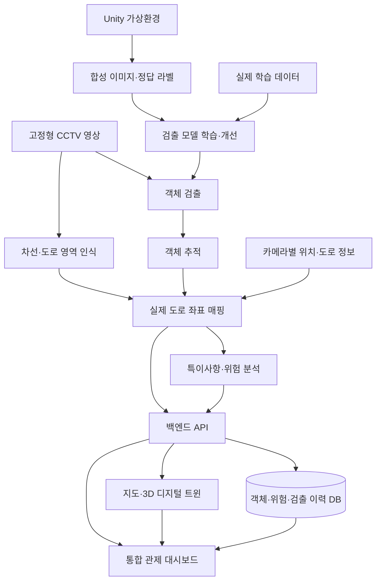

# TwinSight

### CCTV 기반 도로 환경 재구성 및 특이사항 모니터링 시스템

2026학년도 2학기 캡스톤디자인 프로젝트

TwinSight는 고정형 CCTV 영상에서 도로의 객체와 위험 요소를 분석하고, 그 결과를 지도 및 디지털 트윈에 반영하는 도로 모니터링 시스템입니다. 우리 팀은 객체 검출·추적, 도로 인식, 공간 매핑, 가상환경, 웹 서비스를 연결하여 도로의 현재 상태와 특이사항을 한 화면에서 파악할 수 있는 통합 관제 대시보드를 개발합니다.

> 이 문서는 제출한 과제 계획서를 바탕으로 작성한 프로젝트 소개 및 개발 계획입니다. 아래 기능과 기술은 개발 목표와 도입 후보이며, 구현 및 검증 결과에 따라 갱신합니다.

## 프로젝트 배경

도로에서는 포트홀, 균열, 낙하물뿐 아니라 차량의 이상 주행이나 차량·보행자 간 충돌 위험 등 다양한 문제가 발생합니다. 개별 CCTV 확인, 시민 신고, 현장 순찰에 의존하면 위험 상황을 지속적으로 파악하고 신속하게 대응하는 데 한계가 있습니다.

TwinSight는 기존 CCTV를 활용해 도로 상황을 분석하고, 검출된 객체의 위치·이동·위험 정보를 디지털 공간에 모읍니다. 이를 통해 관리자의 관제 부담을 줄이고, 반복적으로 위험이 발생하는 구간과 유지보수 우선순위를 판단할 수 있도록 지원하는 것이 목표입니다.

## 주요 개발 목표

| 기능 | 개발 내용 |
| --- | --- |
| 실시간 객체 검출 | 차량, 보행자, 도로 결함(포트홀·균열), 낙하물 등을 검출 |
| 객체 추적 | 차량·보행자의 객체 ID와 위치, 이동 경로를 추적 |
| 도로 환경 인식 | 차선, 도로 영역 및 도로 구조를 인식 |
| 공간 매핑 | CCTV 영상 속 객체 위치를 실제 도로 좌표와 연계 |
| 디지털 트윈 | 실제 도로 환경과 객체 상태를 지도 또는 3D 공간에 반영 |
| 위험 모니터링 | 객체 간 공간·시간 관계를 분석해 특이사항을 탐지하고 시각화 |
| 통합 관제 대시보드 | 현재 도로 상황, 위험도 히트맵, 알림 및 검출 이력을 제공 |
| 합성데이터 생성 | 가상환경에서 도로·기상·조도·위험 상황을 재현하고 학습·검증 데이터를 생성 |

검출 대상별 적용 범위와 위험 판단 기준은 실제 CCTV 영상에서의 식별 가능성 및 실험 결과를 바탕으로 구체화합니다.

## 시스템 구성 계획

실제 영상의 분석 결과를 지도·디지털 트윈·대시보드로 전달하는 흐름과, 합성데이터를 생성하여 검출 모델을 개선하는 흐름을 함께 개발합니다. 모듈 간 API와 데이터 전달 방식은 구현 과정에서 합의합니다.

## 기술 구성 계획

| 분야 | 기술 후보 | 용도 |
| --- | --- | --- |
| 객체 검출 | YOLOv8 / YOLO11, OpenCV | 차량·보행자·도로 결함·낙하물 검출 |
| 객체 추적 | ByteTrack / BoT-SORT | 객체 ID 유지 및 이동 경로 추적 |
| 도로 환경 인식 | Segmentation, OpenCV | 차선·도로 영역 및 구조 인식 |
| 공간 매핑 | 카메라 좌표 DB, Homography | 영상 좌표와 실제 도로 좌표 연계 |
| 디지털 트윈 | Unity 또는 Web 3D | 도로 환경과 객체 상태 재구성 |
| 지도 시각화 | Mapbox / Leaflet, 3D 시각화 | 위험 위치 및 이동 경로 표시 |
| 백엔드 | FastAPI | 분석 결과 처리 및 데이터 API 제공 |
| 프론트엔드 | React | 실시간 관제 화면 및 디지털 트윈 UI 구현 |
| 데이터베이스 | MySQL / PostgreSQL | CCTV 정보, 객체 위치, 위험도 및 검출 이력 저장 |
| 합성데이터 | Unity 절차적 생성 | 다양한 환경 조건의 데이터 생성 |

각 후보의 최종 선택과 버전은 모듈별 구현 및 통합 검증 이후 기록합니다.

## 팀 구성 및 역할

제출한 과제 계획서 기준으로 다음과 같이 역할을 나누어 진행합니다.

| 팀원 | 담당 분야 | 주요 업무 |
| --- | --- | --- |
| 이진규 | 객체 검출·합성데이터 | 검출 모델 개발, Unity 기반 다양한 도로·기상·조도·위험 상황 데이터 생성 |
| 정재헌 | 객체 추적·디지털 트윈 | 객체 이동 경로 추적, 도로 환경과 객체 상태의 디지털 공간 재구성 |
| 배우준 | 도로 환경 인식·공간 매핑 | 차선·도로 구조 인식, 영상 좌표를 실제 도로 좌표로 변환 |
| 이상민 | 지도 시각화·데이터베이스 | 위험 위치와 이동 경로 표시, CCTV·객체·위험 이력 저장 |
| 이재문 | 백엔드·프론트엔드 | 분석 결과 처리 및 API 개발, 실시간 관제 대시보드와 UI 구현 |

## 개발 단계와 산출물

| 단계 | 팀 작업 | 주요 산출물 |
| --- | --- | --- |
| 1. 조사 및 요구사항 구체화 | 도로 영상·데이터셋 조사, 검출 대상과 위험도 기준 정의 | 실험 대상 및 데이터 구성 계획, 평가 기준 |
| 2. 검출·추적 구축 | 검출 모델과 추적 모듈을 개발하고 영상에서 동작 확인 | 검출·추적 코드, 결과 영상, 객체별 분석 결과 |
| 3. 도로 인식·공간 매핑 | 카메라별 도로 정보와 좌표 변환 구성 | 도로 영역 인식 결과, 좌표 변환 및 매핑 검증 결과 |
| 4. 디지털 트윈·지도 연동 | 객체 위치·이동·도로 상태를 가상공간에 반영 | 지도·3D 시각화, 특이사항 표시 |
| 5. 합성데이터 생성 및 비교 | 가상환경 조건을 바꾸어 데이터를 생성하고 실제 데이터와 함께 활용 | 합성 이미지·라벨, 생성 조건 기록, 모델 비교 결과 |
| 6. 서비스 통합 및 평가 | API·DB·대시보드를 연결하고 전체 흐름 검증 | 통합 시연, 성능 평가, 최종 발표 자료 |

각 모듈은 병행 개발하며, 연동에 필요한 입력·출력 형식을 먼저 합의한 뒤 통합합니다.

## 합성데이터 활용 계획

실제 영상만으로 확보하기 어려운 조건을 Unity 가상환경에서 재현합니다. 도로 구조, 차량·보행자 배치, 카메라 각도, 기상·조도, 도로 결함과 위험 상황을 바꾸면서 이미지와 정답 라벨을 함께 생성합니다.

생성한 데이터는 실제 CCTV 데이터와 함께 모델 학습에 활용하고, 실제 영상에서의 검출 성능을 기준으로 효과를 판단합니다. 가상환경은 실제 도로에서 재현하기 어려운 위험 상황을 반복적으로 검증하는 데에도 활용할 계획입니다.

## 검증 계획

- **검출 성능:** 클래스별 정밀도·재현율·검출률과 실패 사례를 확인합니다.
- **추적·매핑:** 객체 ID의 유지 여부, 이동 경로의 연속성, 실제 도로 위치와 변환 좌표의 일치 여부를 검증합니다.
- **합성데이터 효과:** 학습에 사용하지 않은 동일한 실제 평가 데이터에서 실제 데이터만 학습한 모델과 실제·합성데이터를 함께 학습한 모델을 비교합니다.
- **통합 동작:** 영상 입력부터 지도·디지털 트윈·대시보드 표시까지 연결되는지 확인하고 처리 속도와 표시 지연을 측정합니다.
- **위험 모니터링:** 정의한 위험 상황별 탐지 결과와 알림·히트맵·이력 표시가 일관되는지 확인합니다.

구체적인 목표 수치와 실험 조건, 측정 결과는 실험 진행 후 문서에 추가합니다.

## 모듈 연동 시 정의할 항목

| 연동 구간 | 합의할 정보 |
| --- | --- |
| 영상 입력 → 분석 모듈 | 카메라 ID, 프레임 번호, 촬영 시각, 영상 크기 |
| 검출 → 추적 | 클래스, 바운딩 박스 좌표 및 기준, 검출 신뢰도 |
| 추적·도로 인식 → 공간 매핑 | 객체 ID, 객체의 기준 위치, 도로 영역, 카메라 정보 |
| 공간 매핑·위험 분석 → 백엔드 | 좌표계와 단위, 시각, 객체 상태, 위험 이벤트 및 판단 기준 |
| 백엔드 → 지도·디지털 트윈·대시보드 | API 형식, 갱신 주기, 이력 조회 및 알림 전달 방식 |

위 항목은 연동 규격을 정하기 위한 목록입니다. 백엔드로 들어오고 나가는 형식은 [API 명세](docs/api/README.md)에 정리했습니다.

## 저장소 안내

[Computer-vision](https://github.com/JAEMOON-LEEE/Computer-vision)은 TwinSight 팀의 코드와 개발 문서를 공유하는 저장소입니다.

모듈별 코드가 추가되면 실제 폴더 구조, 필요한 환경과 의존성, 설치·실행 방법, 시연 및 실험 결과를 함께 갱신합니다.

| 폴더 | 내용 |
| --- | --- |
| [docs/data_format.md](docs/data_format.md) | 가상환경 정답·YOLO 검출 결과의 공통 데이터 형식(초안) |
| [simulation/TwinSightSim](simulation/TwinSightSim/README.md) | Unity 가상 CCTV 환경: 이미지·정답 박스·노면 좌표·기준점 저장 |
| [docs/city_lab.md](docs/city_lab.md) | 실제 도시·SUV·Mini 에셋을 조합한 합성데이터 실험 씬, 바퀴 리그 및 실행 안내 |
| [mapping](mapping/README.md) | 공간 매핑(Homography)과 가상환경 정답 기반 오차 평가 |
| [detection](detection/README.md) | YOLO11/v8 객체 검출, Unity·CCTV 입력, 추가 학습·검증 및 팀 연동 |
| [docs/traffic_incidents.md](docs/traffic_incidents.md) | 원본 신호등·보행자, 확률적 사고 생성, 영상 기반 경고와 도로 인식 연동 |
| [backend](backend/README.md) | FastAPI 백엔드: 카메라·검출·경고 API, WebSocket 실시간 전달, ITS CCTV 목록·스트림 갱신, 검출 결과 실시간 연동, 목업 재생 |
| [docs/api](docs/api/README.md) | 백엔드 API 명세(엔드포인트, 요청·응답 예시, WebSocket 이벤트, 검출 모듈 연동 방법)와 openapi.json |
| [frontend](frontend/README.md) | Vite + React + TypeScript 관제 대시보드: 지도·카메라 카드·HLS 재생·검출 박스 오버레이·경고 확인/기각·이력 조회·지연 측정. 2D 디지털 트윈 지도(예시 좌표), 선택 카메라 패널(3D 자리), 위험 이벤트 표, 분석 화면(히트맵·반복 구간·통계) |
| [frontend-proto](frontend-proto/README.md) | 이전 정적 HTML 시제품(보존용) |
| [dev.bat](dev.bat) | 백엔드·관제 화면·목업 재생을 한 번에 띄우는 Windows 개발용 실행 파일 |
