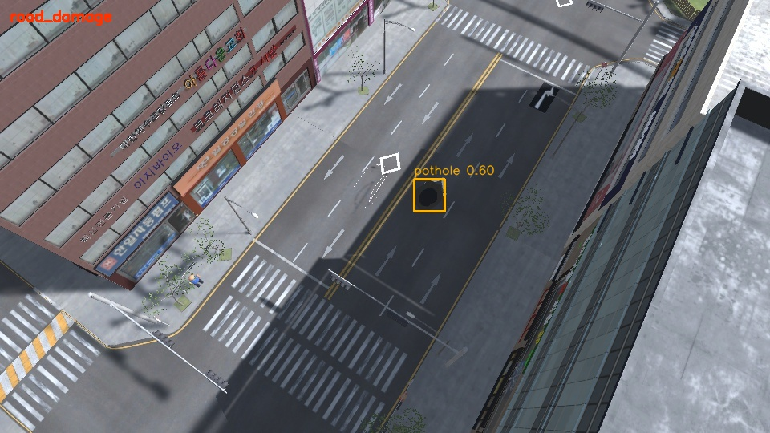

# 초기 검출 모델 및 실행 검증

검증일: 2026-10-18. 차량·보행자는 **COCO 사전학습 기준 모델**, 도로 위험물은 아래의 **합성환경 실험 모델**입니다.

| 항목 | 값 |
| --- | --- |
| 모델 | Ultralytics YOLO11n Detect, COCO 사전학습 |
| 로컬 가중치 | `detection/models/yolo11n.pt` (첫 실행 자동 다운로드, Git 제외) |
| SHA-256 | `0ebbc80d4a7680d14987a577cd21342b65ecfd94632bd9a8da63ae6417644ee1` |
| 런타임 | Python 3.11.9, Ultralytics 8.4.182, PyTorch 2.9.1+cpu, torchvision 0.24.1+cpu, OpenCV 4.11.0.86 |
| 추론 설정 | CPU, 4 threads, imgsz=640, confidence=0.25, IoU=0.7 |
| 검출 대상 | person / car / truck / bus / motorcycle / bicycle |
| COCO 모델에 없는 대상 | pothole / crack / debris / barrier (별도 위험물 모델 사용) |

## 실행 결과

| 확인 항목 | 결과 |
| --- | --- |
| 검출 모듈 자동 검사 | 14개 통과: 박스·클래스 ID·두 모델 연결·입력 시각·경로·라벨 누락·분할 유출 등 |
| 기존 매핑 모듈 검사 | 22개 통과, 새 검출 JSONL도 기존 reader로 읽음 |
| 공식 패키지의 bus.jpg | 버스 1대와 보행자 4명 검출. 라벨이 있는 평가 세트의 정확도 측정은 아님 |
| 위 이미지를 반복한 12프레임 MP4 | 12프레임 처리 완료, 매 프레임 버스 1대·사람 4명. OpenCV 영상 입력·시간 저장 확인용 |
| 기존 Unity CCTV 저장 이미지 8장 | 8개 JSONL 레코드·박스 이미지 저장 완료. truck 검출 15개, 화면에서 건물 오탐과 작은 차량 미검출 확인 |
| 차선 크기 검증용 수직 이미지 | 기본 설정에서 검출 0개. 이 시점·합성 외형에 대한 추가 학습 필요 |
| 도로 위험 학습 설정 | 데이터가 없는 상태에서는 검사 오류로 중단. 실제 추가 학습은 실행하지 않음 |

12프레임 MP4 실행에서 첫 프레임을 제외한 추론 평균은 **174.640 ms**, p95는 **214.053 ms**, 디코딩·박스 이미지 저장·초기 준비를 포함한 처리 속도는 **2.745 fps**였습니다. 현재 PC의 짧은 실행 측정이며, 서로 다른 실제 영상의 속도나 GPU 성능을 뜻하지 않습니다. 현재 검증에서 30fps 실시간 처리는 달성하지 않았습니다.

## 다음 학습의 기준

실제 CCTV 라벨과 검수한 합성 이미지를 확보한 뒤 실제 데이터만 학습한 모델과 실제+합성 모델을 분리된 실제 평가 자료에서 비교합니다. City Lab 원본에 포함된 정적 차량은 현재 자동 라벨 대상이 아니므로 빠진 라벨을 보완해야 합니다. Unity의 가려진 영역까지 포함하는 박스 역시 학습 라벨로 쓸 때 검수가 필요합니다.

이 모듈의 구현·동작 확인, 합성 데이터 학습, 실제 CCTV 성능 검증은 각각 구분합니다. 실제 CCTV 평가 자료는 아직 없습니다.

로컬 결과: `runs/detection/public-sample-baseline`, `video-baseline`, `unity-baseline`, `lane-fit-baseline`.

## 합성환경 위험물 실험 모델

원본 도시 재질을 복원한 Unity 이미지로 pothole / debris / barrier 세 종류를 학습했습니다. 균열은 아직 학습하지 않았습니다.

| 항목 | 값 |
| --- | --- |
| 실험 가중치 | `detection/models/scenario-hazards.pt` (Git LFS로 제공, `git lfs pull` 필요) |
| SHA-256 | `8e2e0be792f509045d9388f66160f19693e30cc8643089f00635fca070637b6e` |
| 최종 학습 | `runs/detection/train_20261018_180558_055177/road-visible` |
| 자료 | `datasets/scenario-safe`: train 64 / val 16 / test 16장, 서로 다른 시드·촬영 세션 |
| 설정 | 초기 합성 모델에 추가 12 epochs, imgsz 416, batch 4, mosaic 0, freeze 10, CPU |
| 별도 합성 test | precision 0.829, recall 0.811, mAP50 0.924, mAP50-95 0.635 |
| 클래스별 test recall | pothole 1.000 / debris 0.434 / barrier 1.000 |

test는 16장·12개 위험물뿐이고 같은 도시·외형을 공유합니다. 위 수치를 실제 CCTV 일반화 성능으로 해석하지 않습니다. 초기 `scenario-prototype` 자료는 차량 가림 문제가 있었으며, 최종 자료는 건물에 가리지 않는 시점과 위험물 라벨을 화면으로 확인했습니다. 자동 라벨 전체에 대한 사람의 검수 완료를 뜻하지 않습니다.

고정 CCTV 연속 영상 `fixed-pothole-warning_20261018_181843`에서 40/40프레임 포트홀 검출과 `road_damage` 경고 1건을 확인했습니다. 경고는 세 번째 프레임에 나왔으며 정답 객체·사고 이벤트를 추론에 사용하지 않았습니다. CPU 두 모델 실행의 warm 평균 132.895ms, 전체 처리 3.152fps였습니다. 결과는 `runs/detection/fixed-pothole-warning/`에 있습니다.

고정 낙하물 영상의 imgsz 416 실행은 40프레임에서 검출·경고가 없었습니다. 이 시점·작은 대상에 대한 추가 자료와 해상도 검증이 필요합니다. COCO 모델의 합성 차량·단순 보행자 검출도 충분하지 않습니다. 충돌 의심 규칙은 입력·추적 기반 자동 검사를 통과했지만, 현재 고정 CCTV 영상에서 모델로 충돌 경고까지 성공했다고 주장하지 않습니다.

최신 자동 검사: Python 검출/경고 26개, 기존 매핑 22개, Unity 신호·양방향 정지선·생성 빈도·사고 물리 접촉 20개 통과. Unity 결과는 `simulation/TwinSightSim/Logs/traffic-scenario-validation.json`에 있습니다.

공유용 검증 기록: [Unity 동작 검사](../docs/validation/traffic-scenario-validation.json), [합성 test 지표](../docs/validation/synthetic-hazards-test-metrics.json), [포트홀 경고 실행](../docs/validation/pothole-warning-summary.json), [경고 레코드](../docs/validation/pothole-alert.jsonl).

## 2026-10-20 가상환경 5종 추가 학습

사용자의 방향 변경에 따라 공개 자료와 ITS 영상은 사용하지 않고, 기존 도시에서 새 합성 이미지 224장(train160/val32/test32)을 만들었습니다. 시점·화각·조명·위험물 크기·차량 수·보행자 배치를 바꿨습니다. YOLO11n COCO에서 person/car/pothole/debris/barrier 5종으로 20epochs, imgsz512, batch8, freeze10, mosaic0.2, CPU 전이 학습을 완료했습니다.

로컬 가중치: `detection/models/simulation-detection.pt`(5,472,858 bytes, Git 제외). SHA-256: `7c444f7f3b0dcb70185c594ffdb3e1ab4a805a3f76c23bc42167a95f2381742e`. 기존 모델은 보존했습니다. bus/truck/motorcycle/bicycle/crack은 이번 모델의 학습 대상이 아닙니다.

같은 합성 test32장에서 이름 기반 IoU0.5/101점 AP 비교는 기존 모델0.474 → 새 모델0.985입니다. confidence0.25에서 차량2/40→40/40, 보행자0/31→29/31(오탐9), 낙하물4/6→3/6으로 모든 항목이 개선된 것은 아닙니다. 작은 대상 누락과 다른 구도의 차량 오탐이 남습니다. 포트홀/낙하물/추돌의심/구조물충돌의심 고정 영상 경고 각1건, 정상 신호대기 대조 경고0건을 확인했습니다. 이는 같은 도시를 공유하는 소규모 실험이며 실제 CCTV 성능을 뜻하지 않습니다.

사용법·라벨 샘플·비교표·검증 JSON은 [가상환경 추가 학습](../docs/synthetic_training.md)에 정리했습니다.

## 2026-10-22 야간 합성 보강

기존 도시·차량·신호 에셋과 CCTV 좌표를 유지하고 낮·밤 조명 선택 기능을 추가했다. 야간 원본240장과 같은 분할의 확대본을 기존 주간 자료와 결합해 학습580/검증200/시험200장으로 구성했다. 기존 큐 모델에서 CPU12epochs/640/batch4/freeze10으로 추가 학습했다. 새 `simulation-cctv-day-night.pt` SHA256은 `7dd2720a7bd8c8757c3a0f38b901b7e6dea46d68e97257916a6810b6947bf1a2`다.

별도 고정 CCTV 야간 합성 test40의 동일 확대 입력 mAP50은 0.9200→0.9943, 차량48/52→51/52 및 오탐9→3, 보행자39/39 유지 및 오탐35→1이다. 주간 test32는 mAP50 0.9556→0.9512로 소폭 감소했다. 실제 CCTV 영상은 학습에 사용하지 않았으며 이 수치는 실제 야간 CCTV 정확도를 뜻하지 않는다. 같은 도시·차량 모형을 공유하는 소규모 자동 라벨 실험이다. 낮·밤 선택, 데이터 분할, 학습 조건과 DB 원본 보관은 [야간 학습 안내](../docs/day_night_training.md)에 기록했다.

후속 RTrees는 주간·야간 train40영상과 기존 train 분할의 검출 특징을 재사용하고 검증20영상으로 선택했다. 주간 시험 사고4/4, 야간 시험 사고3/4에서 경고했으며, 야간1건은 접촉 약54ms 전 경고로 엄격한 접촉 이후 검사에서는 실패다. 정상대기 시험12영상 경고0건이다. 야간 추돌1건과 별도 일반 야간 구조물 충돌 경고 누락이 남아 후속 분류기는 실험 후보로 표시했다. 실제 야간600프레임의 차량 박스884개는 중복·오탐 포함 누적값이며, 자막 오탐이 남고 실제 정답 라벨이 없어 정확도 향상을 주장하지 않는다.

## 사진 기준 고정 CCTV 보강 (2026-10-20)

팀원 금촌 카메라 상대 자세를 City Lab에 복원하고 1차 20epochs + 원거리 확대 8epochs를 완료했다. `simulation-cctv.pt` SHA256 `65fc0eb37fd99c6294746a602533440e7bd25c39c4b3dd435df8521c5254f3b0`. 동일 카메라·원거리 확대 입력으로 별도 고해상도 test32 mAP50 0.17867→0.94126. 새 모델의 포트홀은 6/7 검출 및 오탐1, 보행자 오탐6으로 완성된 실 CCTV 모델은 아니다. 전체+확대는 각각 기존 ByteTrack을 사용하며 결과를 원본 좌표로 복원한다. 별도 5종 90프레임 영상에서 정상대기0, 포트홀2, 낙하물2, 추돌의심1, 구조물충돌의심1을 확인했다. 위험물2건은 15초 재경고다. 충돌 중복 억제 후 동일 검출450프레임 재생 검증. 신호대기영역 내 실제 충돌 누락 가능성, 영역 경계의 추적 ID 변경, 자동 가림 박스, 같은 도시/모형 공유 한계가 남는다. 상세 설정·실행·근거는 [고정 CCTV 학습](../docs/cctv_training.md).

## 신호 대기 구역 내부 사고 보강 (2026-10-21)

기존 금촌 CCTV와 도시·차량 에셋을 유지한 양방향 대기 구역에서 정상 대기·좁은 간격 대기·구조물 앞 안전 정지·추돌·구조물 충돌을 구현했다. 겹친 차량을 분리 검출하도록 YOLO를 추가 8 epochs 학습했다. 객체 자료는 기존 위험물 유지 샘플을 포함한 train260/val120/test120장이며, train과 val/test는 촬영 세션별로 분리했다. 최종 학습의 val mAP50은 0.992로 실제 CCTV 평가가 아니다.

- 검출: `simulation-cctv-queue.pt`, SHA256 `d9b55172132a8e0689565536deae545393a8c7cff3dfde625f9a91877ab7feea`.
- 대기 구역 판정: `stop-zone-collision-final.xml`와 동명 JSON, SHA256 `46ff66644f1e049de2c9ebeaf336724f6e18ef4e6d97af1b55bc5ead73fb1e03`.
- OpenCV RTrees 128 trees, depth6, 박스·과거 움직임 25개 특징. train20/val10/test10개 연속 영상, 각40프레임/5fps. 학습171사례(정상107/접촉64). val로 선택한 임계값0.51은 투표 비율이며 보정된 확률이 아니다.
- 최종 test: 추돌2/2·구조물 충돌2/2 각1건, 정상 대조6개에서 경고0건. val도 사고4/4·정상6/6 통과. 학습 정답은 실제 Unity 물리 접촉과 객체 매칭을 사용했고, 경고에는 정답·이벤트·시나리오 이름을 주지 않았다.
- 기존 450프레임 회귀 시험: 정상0/포트홀2/낙하물2/추돌1/구조물충돌1. 기존 가중치는 보존한다.

대기 구역 내부 사고 경고는 `--stop-model`로 이 모델을 명시해야 활성화된다. 해당 모델은 위 YOLO 및 같은 원거리 확대·카메라 보정과 함께 사용한다. 같은 도시·외형을 공유하는 작은 합성 시험이며 실제 CCTV, 완전 가림, 다른 신호 대기 행태의 성능을 보장하지 않는다. 구현·명령·증거는 [대기 구역 학습 안내](../docs/stop_zone_training.md).

## 실제 CCTV 검증 (2026-10-22)

팀원 대시보드의 ITS 연결을 통해 금촌신사거리 실제 야간 영상120초에서600프레임을 평가했다. 평가 영상은 학습에 넣지 않았다. 기존 합성 모델+원거리 확대의 차량 박스 누적471건과 포트홀 예측3건, 경고0건을 기록했다. 정답 라벨이 없어 이 수치를 정확도나 실제 차량 수로 해석하지 않는다. 자막을 차량으로 검출하는 오탐과 야간 차량 누락이 확인됐으며 실제 사고 양성 영상이 없어 사고 재현율은 미평가다. 실제 카메라용 도로 보정의 stop_zones가 비어 있어 합성 신호대기 분류기의 실 CCTV 성능도 미검증이다. 기본 COCO 모델 역시 야간 누락이 많았다. 실제용으로 완성됐다고 보지 않는다.

대시보드는720×480 영상 프레임 연결과 실제 검출 데이터의 REST/WS 전달이 확인됐지만 브라우저 재생 정지 현상이 있었고 영상/박스 시간 동기화는 통과로 판정하지 않았다. [실제 CCTV 검증 기록](../docs/real_cctv_validation.md)에 출처·설정·JSON·화면 근거와 남은 작업을 정리했다.
