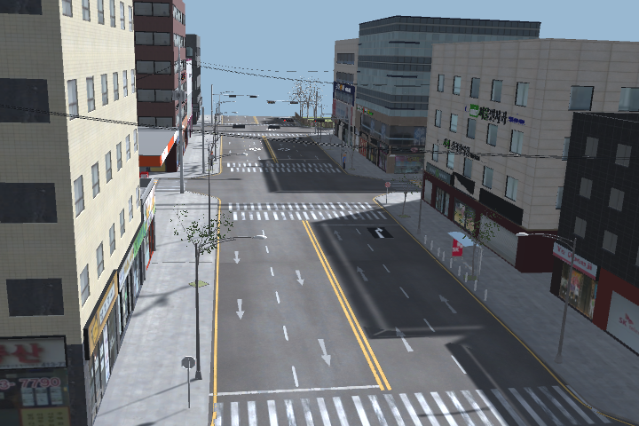
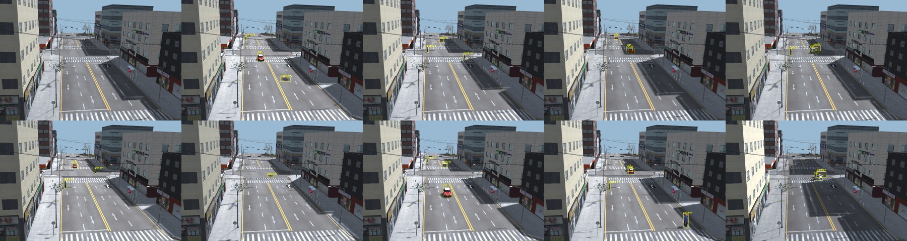
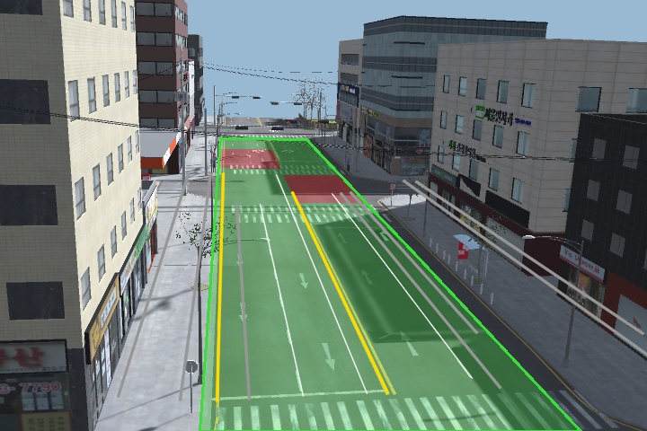
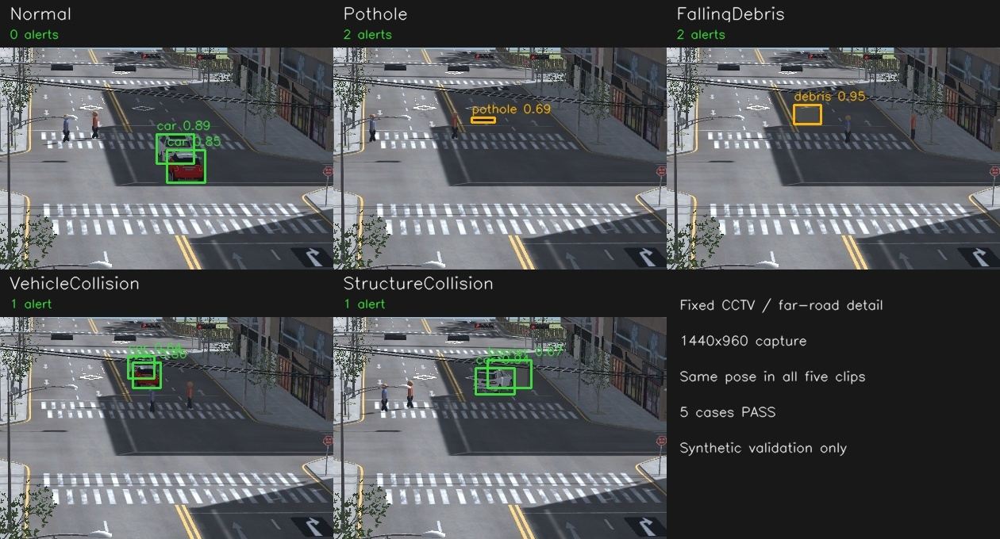

# 사진 시점의 고정 CCTV 학습

팀원 `baewoojun`의 `feat/vehicle-assets` 브랜치 `2b75753`에 저장된 `RealCctv/geumchon.road_pose.json`과 `CityLabCctvPlacer` 계산을 재사용했다. 복원 화면은 요청 사진의 건물·횡단보도 배치에 일치한다. 실제 금촌 도로의 전역 위치를 도시 에셋에 그대로 적용한 것은 아니며, 도로 기준 상대 자세를 City Lab 축척으로 옮긴 것이다.

| 설정 | 값 |
| --- | --- |
| Unity 위치 X/Y/Z | -17 / 5.017182 / 1.833129 |
| Unity 회전 X/Y/Z | 14.164289 / 98.992683 / 1.943732 도 |
| 세로 화각 | 38.015118 도 |
| 기준 사진 / 최종 촬영 해상도 | 720 × 480 / 1440 × 960 (같은 화면비·시점) |
| 가정한 축척 | Unity 1단위 = 2.92 m |
| 실측 자세 원본 | 높이 13.169733 m, 도로 대비 yaw 8.992678 도 |

실제 기준 교차로까지 거리는 255 m이지만 City Lab 직선 도로가 짧아 팀원 배치 도구와 동일하게 X=-17로 제한한다. [내보낸 카메라 정보](validation/geumchon-v1/camera.json)에 정밀 좌표와 투영 행렬을 기록했다.



## Unity 촬영

`CityTrafficLab`에서 Play를 멈추고 **TwinSight → City Lab → Restore Reference CCTV (Geumchon)**을 실행한다. 도시 재생성·신호 설치·차선 정렬 후에도 이 프로필을 적용한다. 도로 원본 재질과 에셋 신호등은 기존 것을 유지한다.

Play 후 **Capture Varied Training Dataset (Play Mode)**를 실행하면 고정 시점에서 train 240(seed 6201), val 48(7302), test 48(8403)장을 만든다. `TwinSightExport/geumchon-v1-*`에 이미지와 객체 정답을 저장한다. 시점을 바꾸지 않고 조명, 거리, 위험물 크기, 차량 수와 보행자 배치를 바꾼다. 기존 SUV/Mini와 사고 생성기를 사용하며, 라벨 없는 원본 주차 차량은 촬영 중 숨긴다. 끝나면 Play를 중지한다.



원거리 보강은 별도 Play에서 **Capture Reference CCTV Detail Dataset (Play Mode)**로 1440×960의 train 120(seed 7201), val 32(8302), test 32(9403)장을 촬영한다. 원본 화면에 가까운 그림자 조건과 일부 충돌 전 접근 장면을 포함한다.

별도 Play에서 **Capture Reference CCTV Detail Warning Clips (Play Mode)**를 실행한다. 정상 신호 대기·포트홀·낙하물·추돌·구조물 충돌을 같은 카메라로 각각 90프레임/5fps 촬영한다. 정상 대기는 실제 정지선 제어를 사용한다. 충돌은 물리 접촉으로 발생시키지만, 경고 추론에는 사고 정답을 전달하지 않는다.

## 팀원 OpenCV 연결

도로 인식은 팀원의 `mapping/twinsight_mapping/road.py`, `scripts/detect_road_context.py`, 관련 검사를 재사용한다. 객체 검출 모델과 별도로 도로·정지 영역을 만들고 경고 엔진의 `--context`로 연결한다. 고정 CCTV 보정과 같은 해상도의 차량 없는 원본 배경을 사용한다. 임의 조명 배경에서는 도로를 한쪽만 찾는 경우가 있어 결과 확인이 필요하다.

모든 횡단보도 앞 영역을 경고에서 제외하면 하류 사고도 누락된다. `--controlled-stop-ground`를 추가해 OpenCV 정지 영역 중 이 장면의 실제 신호 정지선 두 곳만 선택했다. 이는 고정 보정 좌표이며 실행 중 신호 상태·사고 정답을 읽는 방식은 아니다.

```powershell
.\.venv\Scripts\python.exe mapping/scripts/detect_road_context.py --export "<고정촬영세션>" --frames "<차량없는720x480배경>" --meters-per-unit 2.92 --controlled-stop-ground "6.8,-1.06" --controlled-stop-ground "9.65,0.24" --out detection/config/geumchon-city-lab.context.json
```



`detection/config/geumchon-city-lab.context.json`은 이 카메라 전용이다. 카메라나 도로를 바꾸면 다시 보정한다. 도로 선 후보에 보도·음영의 오인식도 남으며 도로 재구성의 완전한 정답으로 보지 않는다. 정상 신호 대기 경고 0건이 목표다. 기본 모델은 신호 대기 구역 내부의 실제 추돌을 억제한다. 이후 [대기 구역 사고 보강](stop_zone_training.md)에서 양방향 사고를 추가 학습하고 별도 판정 모델을 지정해 이 구역도 경고하도록 확장했다.

## 학습과 실행

클래스는 `person,car,pothole,debris,barrier`이며 충돌은 검출·추적 결과의 접근, 겹침, 급정지로 판정하는 의심 경고다. 원거리 차량은 픽셀 이동이 작으므로 0.35초 이상 일정 방향으로 접근했는지 확인하고, 단발성 박스 흔들림은 접근 근거에서 제외한다. 충돌 때 차량에 가려지는 구조물은 두 번 이상 확실히 검출된 경우에만 최대 1초 유지한다. 경고 근거에 마지막 관측 시각과 일시 가림 여부를 기록한다. 같은 위치의 위험물은 추적 ID가 바뀌어도 재경고 대기 시간을 유지한다.

원거리 도로 `(230,130)–(440,270)`(720×480 기준)을 별도로 확대해 학습한다. 전체 화면 240장과 보강 확대 120장을 합친 train 360장, val/test 각 80장의 분할을 유지한다. 추론에서도 전체 화면과 확대 영역을 각각 기존 YOLO/ByteTrack으로 처리한다. 확대 영역 안은 확대 결과만 사용해 중복 경고를 방지하고, 박스 좌표는 원본 해상도로 되돌린다. 영역 경계에서는 추적 ID가 바뀔 수 있다.

```powershell
.\.venv\Scripts\python.exe -m detection prepare-unity --train "<train세션>" --val "<val세션>" --test "<test세션>" --classes person,car,pothole,debris,barrier --out datasets/geumchon-v1
.\.venv\Scripts\python.exe -m detection train --data datasets/geumchon-v1/dataset.yaml --weights detection/models/simulation-detection.pt --epochs 20 --imgsz 640 --batch 8 --device cpu --freeze 10 --mosaic 0 --name geumchon-v1
.\.venv\Scripts\python.exe -m detection prepare-unity --train "<고해상도train>" --val "<고해상도val>" --test "<고해상도test>" --classes person,car,pothole,debris,barrier --out datasets/geumchon-detail-full
.\.venv\Scripts\python.exe -m detection.prepare_focus --full-data datasets/geumchon-v1/dataset.yaml --detail-data datasets/geumchon-detail-full/dataset.yaml --out datasets/geumchon-focus
.\.venv\Scripts\python.exe -m detection train --data datasets/geumchon-focus/dataset.yaml --weights "<1차 best.pt>" --epochs 8 --imgsz 640 --batch 8 --device cpu --freeze 10 --mosaic 0 --name geumchon-focus
.\.venv\Scripts\python.exe -m detection predict --source "<1440x960고정촬영세션>" --weights detection/models/simulation-cctv.pt --imgsz 640 --focus "0.319444444,0.270833333,0.611111111,0.5625" --alerts --context detection/config/geumchon-city-lab.context.json --save-images
.\.venv\Scripts\python.exe -m detection.verify_simulation --out runs/geumchon-v1/verification
```

공개 자료·ITS 영상은 이번 학습에 사용하지 않는다. 서로 다른 시드로 자료를 나눴지만 같은 도시·외형·카메라를 공유하는 합성 실험이다. 자동 박스는 가림을 포함할 수 있고 일부 작은 박스는 학습에서 제외된다. 실제 CCTV 또는 다른 시점에서의 성능을 보장하는 결과가 아니다.


## 최종 검증 결과

1차 20 epochs와 원거리 보강 8 epochs를 완료했다. 최종 모델은 `detection/models/simulation-cctv.pt`이며 SHA-256은 `65fc0eb37fd99c6294746a602533440e7bd25c39c4b3dd435df8521c5254f3b0`이다. 기존 모델 파일은 보존했다. 원거리 보강 실행은 `runs/detection/train_20261020_230929_923687/geumchon-focus`에 남겼다.

| 별도 1440×960 test 32장 | 이전 합성 모델 | 새 CCTV 모델 |
| --- | --- | --- |
| mAP50, 101점 AP | 0.179 | 0.941 |
| 차량 검출 / 정답 40 | 21 | 40 |
| 낙하물 검출 / 정답 6 | 1 | 6 |

위 두 모델 모두 같은 확대 영역을 사용했다. 검출 수는 confidence 0.25, 박스 IoU 0.5 기준이다. 새 모델은 보행자 30/31(오탐 6), 차량 40/40(오탐 1), 포트홀 6/7(오탐 1), 낙하물 6/6, 구조물 6/6을 검출했다. 누락과 오탐이 모두 사라진 결과는 아니다. 별도 720×480 test 48장의 mAP50도 기존 전체 화면 실행 0.282에서 새 전체+확대 실행 0.964로 개선됐으며, 이 비교에는 입력 처리 변경 효과도 포함한다.

| 같은 고정 CCTV, 각각 90프레임/5fps | 최종 경고 |
| --- | --- |
| 정상 신호 대기 | **0건** |
| 포트홀 | road_damage 2건 |
| 낙하물 | road_debris 2건 |
| 차량 추돌 | suspected_vehicle_collision 1건 |
| 구조물 충돌 | suspected_vehicle_structure_collision 1건 |

위험물은 15초 재경고 주기 때문에 긴 영상에서 2건 발생한다. 충돌은 겹침이 유지되는 동안 한 번만 알리고, 분리 상태가 1초 이상 이어져야 다시 판정한다. 최종 중복 방지 변경은 같은 450프레임의 검출 결과를 경고 엔진으로 재생해 확인했다. 모델과 검출 결과는 바꾸지 않았다. 정상 차량은 정지선 앞 약 0.079 Unity 단위에서 멈췄고 마지막 10프레임 위치 변화도 0이었다.

이 수치는 이 5개 합성 시험 영상의 동작 확인이며 실제 CCTV의 사고 탐지율이나 모든 정상 대기 상황의 무오탐을 뜻하지 않는다. 충돌 경고는 영상 확인이 필요한 `unconfirmed` 상태다. 자동 검사는 detection 37개, mapping 26개가 통과했다.

[시험 이미지 평가](validation/geumchon-v1/highres-trained.json) · [이전 모델](validation/geumchon-v1/highres-baseline.json) · [720×480 평가](validation/geumchon-v1/lowres-trained.json) · [경고 검증](validation/geumchon-v1/warning-clips.json) · [물리 접촉·신호 대기 확인](validation/geumchon-v1/scene-audit.json)

아래는 동일한 CCTV 영상의 원거리 부분만 확대해 검출 근거를 보여 준 그림이다. 촬영 카메라를 옮긴 것이 아니다.


