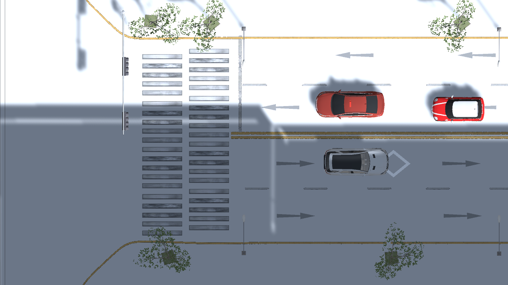

# Unity 도시·차량 합성데이터 실험 환경

이 환경은 이진규 담당의 **Unity 합성데이터 생성 및 CV 검증**을 위한 장면입니다. 정재헌 담당의 실시간 CCTV 객체 추적·디지털 트윈과 연동하기 전, 가상 영상과 정답 데이터를 만드는 데 사용합니다.

## 구성

- 저장소의 `south_korea_FBX.fbx` 도시와 Papabear 차량 에셋 중 SUV·Mini 2종을 사용합니다.
- 원본 FBX를 보존하고, Unity에서 읽은 메시의 연결된 면을 분석해 차체와 네 바퀴를 분리합니다.
- 타이어·휠의 UV, 법선, 재질을 유지하고 바퀴 중심에 회전축을 생성합니다.
- 주황색 중앙선과 가운데 점선 사이의 폭(약 1.2 Unity 단위)을 측정해 차량 폭을 최대 0.7로 맞췄습니다. 비율을 유지한 길이는 SUV 약 1.6, Mini 약 1.3입니다. 루트는 바닥 중심이고 앞은 +Z입니다. 실제 도시의 측량 축척과 동일하다고 가정하지 않습니다.
- 두 내부 차선의 중앙으로 경로도 정렬했습니다(출차 방향 world Z=-1.06, 반대 방향 Z=0.24). 폭만 줄이고 점선 위를 달리는 일이 없도록 차선 내부 여유를 검증합니다.
- 바퀴 회전량은 실제 이동 거리 ÷ 반지름으로 계산합니다. 정지하면 멈추고 후진하면 반대로 회전합니다. 앞바퀴 조향축도 포함합니다.
- 도시의 도로 재질에 해당하는 면만 노면 Collider로 만들고, 연속된 양방향 주행 구간을 찾습니다.
- 가상 CCTV, 전체 관찰 카메라, 차량 생성기와 기존 `GroundTruthExporter`를 연결합니다.

차량은 경로를 따라 이동하는 **운동학적 합성 교통 모델**입니다. 차량 동역학·타이어 마찰·충돌 회피 시뮬레이터는 구현 범위에 포함되지 않습니다. 최초 씬의 경로는 직선 양방향이며 조향축은 이후 곡선 경로 확장에도 사용할 수 있습니다.

## 준비 및 생성

1. Git LFS가 설치된 상태에서 저장소를 내려받습니다. 기존 체크아웃이면 필요한 원본 에셋을 받습니다.

   ```powershell
   git lfs pull --include="south_korea_FBX.fbx,south_korea_textures/**,Papabear_Papabear Car Package/suv_승용차/**,Papabear_Papabear Car Package/mini_coo0er_미니0퍼/**"
   ```

2. Unity Hub의 **Add project from disk**에서 `simulation/TwinSightSim`을 추가하고 Unity **6000.6.6f1**로 엽니다. `New project`로 하위 프로젝트를 만들 필요는 없습니다.
3. 컴파일 완료 후 **TwinSight → City Lab → Build City Traffic Lab**을 실행합니다. 최초에는 대형 도시 FBX와 텍스처를 임포트하므로 시간이 걸립니다.
4. 생성된 `Assets/TwinSight/CityLab/CityTrafficLab.unity`를 엽니다. 생성 직후에는 이 씬이 자동으로 열립니다.
5. **Game 뷰**에서 Play를 누릅니다. `Traffic` 아래 두 생성기가 실제 차량 프리팹을 생성합니다.

생성 메뉴를 다시 실행하면 `Assets/TwinSight/CityLab`의 실험용 프리팹·메시·씬을 갱신합니다. 이 폴더에 수작업으로 변경한 씬을 보관하려면 다른 폴더로 저장하세요. 원본 에셋과 기존 `DemoRoad`는 변경하지 않습니다.

원본 LFS 파일 대신 100여 바이트의 포인터 파일만 있으면 임포트를 중단하고 누락된 파일 경로를 알려줍니다. 임포트 복사본과 생성 결과는 `.gitignore`로 제외하며, 팀원은 같은 생성 메뉴로 재구성할 수 있습니다.

## 실험 조작

Game 뷰에 포커스를 두고 사용합니다.

| 조작 | 동작 |
| --- | --- |
| F1 | 고정 CCTV 시점 |
| F2 | 도시·도로 전체 관찰 시점 |
| Space | 시뮬레이션 일시정지·재개 |
| E | 현재 실행에서 CCTV 이미지·정답 저장 시작(한 번) |
| `ExperimentSettings` Inspector | 시뮬레이션 배속과 태양 광량 조절 |
| `Traffic/Outbound`, `Traffic/Inbound` Inspector | 차량 속도, 생성 간격, 차량 종류 비율, 시드 조절 |
| `VirtualCCTV` Inspector | 카메라 위치·화각, 해상도, 저장 프레임 수 조절 |

저장은 기본적으로 꺼져 있습니다. 차량이 충분히 나타난 뒤 E를 누르면 기존 형식의 이미지와 정답을 저장합니다. 기본 설정은 1280×720, 10fps, 100프레임입니다. 다시 수집하려면 Play를 종료하고 새로 실행합니다.

## 출력 및 검증

- 데이터: `simulation/TwinSightSim/TwinSightExport/city-lab-cctv-01_<시각>/`
- 형식: `frames/*.jpg`, `ground_truth.jsonl`, `camera.json`, `control_points.json`. 자세한 정의는 [data_format.md](data_format.md)를 참고합니다.
- 차량 검증: **TwinSight → City Lab → Validate Vehicle Rigs**. 원본과 분리 결과의 삼각형 수, 네 바퀴와 회전축, 이동 거리 대비 회전량, 정지·후진·순간이동 처리를 확인합니다.
- 로컬 진단: Unity 프로젝트의 `Logs/SUV-rig.json`, `Mini-rig.json`, `city-lab-build.json`, `city-lab-validation.json`.
- 차선 검증: `Logs/lane-fit-proof.png`의 수직 화면과 `lane-fit-validation.json`으로 확인했습니다. 차량과 주황색 선·점선 사이의 최소 여유는 0.22 Unity 단위입니다. 프리팹 재생성 시 메시 정점 버퍼도 갱신해 이전 크기가 화면에 남지 않도록 합니다.

정답 박스는 기존 exporter와 같이 가려진 부분까지 포함합니다. 합성데이터로 검출기를 평가할 때에는 실제 영상 평가 결과도 함께 비교해야 합니다.

자동 라벨 대상은 생성기가 만든 SUV·Mini입니다. 도시 원본에 포함된 정적 차량 등도 학습 대상에 넣으려면 해당 오브젝트에 `TrackedObject`를 추가해 라벨링해야 합니다.

2026-10-18 Unity 6000.6.6f1에서 확인한 차량 검증 결과:

| 차량 | 원본 / 분리 후 삼각형 수 | 길이 / 폭(Unity 단위) | 바퀴 |
| --- | --- | --- | --- |
| SUV | 98,320 / 98,320 | 1.60 / 0.70 | 4개, 이동·정지·후진·순간이동 검증 통과 |
| Mini | 68,104 / 68,104 | 1.30 / 0.70 | 4개, 이동·정지·후진·순간이동 검증 통과 |

아래 수직 검증 화면에서 아래쪽 회색 SUV와 위쪽 오른쪽 빨간 Mini가 주황색 선과 점선 사이에 들어갑니다. 위쪽 왼쪽 차량은 도시 원본에 포함된 정적 차량입니다.



## 주요 코드

| 파일 | 역할 |
| --- | --- |
| `Editor/CityAssetTools.cs` | LFS 실데이터 확인, 원본 복사 및 임포트 |
| `Editor/CityMaterialBuilder.cs` | FBX의 원래 확산 텍스처 연결을 읽어 도시 재질 복원 |
| `Editor/VehicleRigBuilder.cs` | 연결된 메시 면 분석, 바퀴 추출·회전축·프리팹 생성 |
| `Editor/CityLabBuilder.cs` | 도시·도로 Collider·양방향 차량·카메라·exporter 구성 |
| `Editor/CityLabValidation.cs` | 차량 분리·회전 검증, 카메라 미리보기 렌더링 |
| `Scripts/VehicleWheelAnimator.cs` | 이동량에 따른 바퀴 회전 및 앞바퀴 조향 |
| `Scripts/CityLabExperiment.cs` | 카메라 전환, 일시정지, 데이터 수집 시작 및 실험 설정 |

경로는 `simulation/TwinSightSim/Assets/TwinSight` 기준입니다. 다른 차량을 추가할 때에는 실제 메시 구조와 앞 방향을 먼저 확인하고, `VehicleRigBuilder.Build`의 입력 모델·이름·길이를 지정합니다. 네 바퀴를 안전하게 식별하지 못하면 부분적인 리그를 저장하지 않고 중단합니다.
