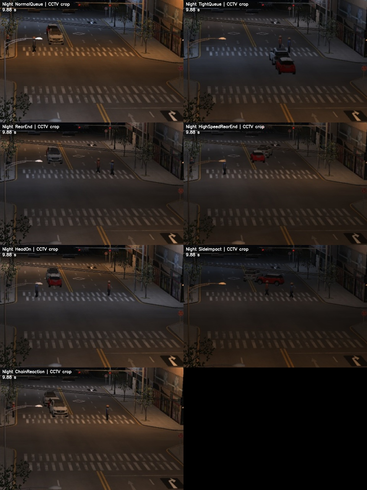

# 주간·야간 차량 충돌 재학습

## 학습 범위

사용자가 추가한 일반/고속 후방 추돌, 정면충돌, 측면충돌, 연쇄 추돌의 낮·밤 영상을 사용한다. 정상 신호 대기와 간격이 좁지만 접촉하지 않은 대조도 포함한다. 기존 도시·차량·카메라를 공유한 합성 실험이며 실제 CCTV 사고 정확도 검증과 구분한다.

학습은 두 단계다. YOLO는 차량·보행자·포트홀·낙하물·구조물의 박스를 검출하도록 보강한다. 별도 충돌 판정 모델은 검출 박스·추적 이력의 시간 변화를 학습한다. 사진의 차량 박스만으로 사고를 판정하는 모델로 설명하지 않는다.

## 데이터와 분할

전체 혼합본4,340장과 원본42클립/3,360프레임을 보존했다. 매 클립의 반복 정차 프레임이 과도하게 학습되지 않도록16프레임을 선택한 버전을 사용한다. 새 클립의 낮·밤 비중은 같다.

| 분할 | 기존 다섯 객체 클래스 자료 | 새 충돌 대표 프레임 | 합계 |
|---|---:|---:|---:|
| train | 580 | 224 | 804 |
| val | 200 | 224 | 424 |
| test | 200 | 224 | 424 |

설정은 `datasets/day-night-collision-v2/dataset.yaml`, 출처와 대표 프레임 번호는 같은 폴더의 `provenance.json`이다. 촬영 클립의 원래 분할을 유지하며 프레임을 무작위로 나누지 않는다. 기존 위험물 라벨과 클래스 ID를 보존했다. 자동 정답에는 가림이 포함되며 전체 사람 라벨 검수는 완료하지 않았다.

충돌 판정은 새 train14클립과 기존 train40클립으로 학습한다. 기존40클립의 이전 검출기 출력은 보강 자료로 사용하고 그 출처를 기록한다. val34클립은 새 검출기로 다시 추론해 선택에 사용한다. test34클립은 모델·임계값 선택이 끝난 뒤 평가한다. 이는 이전에 문제 진단에 사용한 **고정 회귀 벤치마크**이며 새 카메라의 맹검 시험은 아니다.

## 방법

- 검출기: 기존 `simulation-cctv-day-night.pt`를 시작점으로 CPU/640/batch4/freeze10/최대12epochs/patience5. 최적 가중치는val 기준으로 선택한다. 이전 모델을 덮어쓰지 않는다.
- 충돌 판정: 기존25개 시각 특징에 신뢰도·쌍 이력·4초 범위의 접근과 크기 변화 등을 더한32개 특징의 OpenCV RTrees다. 서로 다른12개 용량 설정과 임계값을val에서만 비교한다. 오경고 최소, 주야간 인식 균형, 전체 사고 인식 순으로 선택한다.
- 양성 라벨은 실제 물리 접촉 이후의 올바른 두 객체다. 같은 차량을 중복 검출한 두 박스, 접촉 전 접근, 정상 정지 등은 음성 사례다. 정답 객체와의 박스 IoU0.3 매칭으로 오프라인 라벨을 만든다.
- 추론은 시나리오명·신호 정답·접촉 이벤트·실제 좌표를 읽지 않는다. 두 객체를0.5초 이상 관측하고, 간격이 박스 높이의0.1 이상 줄어든 이력이 있어야 한다. 높은 학습 점수도3프레임/최소0.25초 유지해야 경고한다. 처음부터 서 있는 차량은 점수만으로 사고 경고를 내지 않는다.

학습·캐시·임시파일·결과는 D드라이브에 둔다. 실행기는 `D:\Capston disign\tools\Run-ProjectPython.ps1`이다. 실험 코드는 기존 `detection/`의 데이터 검사·검출기·경고 계약·특징 추출을 재사용한다.

```powershell
& 'D:\Capston disign\tools\Run-ProjectPython.ps1' -m detection.retrain_collision_detector
& 'D:\Capston disign\tools\Run-ProjectPython.ps1' -m detection.train_collision_policy
& 'D:\Capston disign\tools\Run-ProjectPython.ps1' -m detection.evaluate_collision_retraining
```

완료된 실험 폴더나 가중치가 있으면 재실행으로 덮어쓰지 않는다. 새 실험은 별도의 버전 경로를 사용해야 한다.

## 실행과 수동 확인

검출 가중치는 `detection/models/simulation-cctv-collision-v2.pt`, 충돌 판정은 `detection/models/collision-policy-v2.xml`과 동명JSON이다. 두 모델은 SHA256으로 연결되며 다른 검출 가중치와 섞으면 실행을 중단한다. 이전 모델은 비교용으로 유지한다.

가상환경의 고정 CCTV 클립을 검사하는 예시다. 결과 폴더는 비어 있는 새 경로여야 한다.

```powershell
& 'D:\Capston disign\tools\Run-ProjectPython.ps1' -m detection predict `
  --source '<Unity 클립 폴더>' `
  --weights detection/models/simulation-cctv-collision-v2.pt `
  --focus 0.319444444,0.270833333,0.611111111,0.5625 `
  --context detection/config/geumchon-city-lab.context.json `
  --collision-model detection/models/collision-policy-v2.xml `
  --alerts --out runs/collision-v2-manual-check
```

수동 검증 대시보드에서는 학습·시험 완료 후 **충돌 보강 주간·야간 모델**을 선택한다. 가상환경 영상은 **고정 카메라**, **초당5/8장**, **가상 CCTV 전용 충돌 판정 사용**을 함께 선택한다. 원거리 차량이 잘 보이는 입력 영역을 사용하고 사고 전3초 이상부터 검사한다. 사진 한 장 검사는 충돌 판정을 사용하지 않는다.

실제 CCTV에는 가상환경 전용 충돌 판정을 자동 적용하지 않는다. 새 YOLO만 선택해 객체 검출을 비교할 수 있지만 실제 사고에 대한 정답 자료가 없으므로 정확도·사고 재현율을 주장하지 않는다. 모델은 합성 실험 후보이며 `production_ready=false`다.

## 결과 기록

학습 진행 기록은 `runs/collision-v2/progress.json`, 실제 완료는 `detector-complete.json`, `policy-verification.json`, `object-comparison.json`으로 구분한다. 단순히 진행 로그가 있다는 이유로 학습·시험 완료로 설명하지 않는다. 최종 수치와 남은 실패 사례는 모든 단계가 끝난 뒤 이 문서에 기록한다.

D드라이브 연결 해제로 중단된 마지막 검사는 저장된 모델을 그대로 사용해 `detection.train_collision_policy --verify-only`로 재개했다. 중단된 출력 폴더를 보존하고 미완료 예측만 다시 계산했다. 이전에 끝난19클립의 재검사 결과는 같았으며 모델·임계값을 다시 학습하거나 변경하지 않았다.


## 2026-10-25 완료 결과

검출기는12epochs 학습을 완료했고, 별도 충돌 판정 모델의 학습·선택·시험도 완료했다. 이전 가중치는 보존했다.

| 고정 시험 | 이전: 올바른 접촉 후 경고 | 재학습: 같은 기준 | 이전 정상 충돌 오경고 | 재학습 정상 충돌 오경고 |
|---|---:|---:|---:|---:|
| 새 주간 사고 | 1/5 | 5/5 | 0/2 | 0/2 |
| 새 야간 사고 | 4/5 | 5/5 | 1/2 | 0/2 |
| 기존 주간 사고 | 4/4 | 3/4 | 0/6 | 0/6 |
| 기존 야간 사고 | 2/4 | 3/4 | 0/6 | 0/6 |

표의 성공은 실제 접촉 이후 올바른 쌍으로 경고하고 같은 클립에 잘못된 쌍·조기 경고가 없는 경우다. 객체 검출 mAP와 차량 쌍 경고는 별도 지표다.

연쇄 추돌도 실제 접촉한 쌍을 한 번 이상 올바르게 경고하면 장면 성공으로 센다. 모든 개별 접촉 쌍을 빠짐없이 경고했다는 뜻은 아니다. 표본이 작고 같은 도시·차량을 공유하므로 실제 CCTV 정확도로 바꾸어 설명하지 않는다.

재학습 모델의 정상 대조16개 중 모든 경고 유형을 합쳐 경고가 발생한 영상은 0개다. 유형별 기록도 비교 증빙에 포함했다.

동일한 객체 시험424장에서 mAP50은 0.9192 → 0.9233다. 클래스·주야간별 결과는 증빙의 객체 비교 파일에 기록했다.

남은 충돌 판정 실패 사례:

- legacy / Day / StructureImpact: 접촉 후 올바른 쌍 경고=False, 잘못된 쌍·조기 경고=0, 경고 수=0
- legacy / Night / RearEnd: 접촉 후 올바른 쌍 경고=False, 잘못된 쌍·조기 경고=0, 경고 수=0

실제 CCTV 사고 정확도·새 카메라 일반화·새 사건의 맹검 성능을 뜻하지 않는다. 전체 라벨 사람 검수도 미완료다. 모델은 실험 후보 상태로 유지한다.

[전후 비교 증빙](validation/collision-v2/comparison.json) · [객체 결과](validation/collision-v2/objects.json) · [시험별 경고](validation/collision-v2/after-temporal.json)

대시보드에서도 야간 연쇄 추돌 WebM을0~7.5초/8fps로 검사했다.61프레임을 처리해4.25초에 경고1건을 표시하고 자동 OFF했으며 D드라이브에 보고서를 저장했다. 원본 프레임으로 환산해 실제 접촉 쌍과 접촉 이후 시각임을 오프라인으로 대조했다. [화면 연결 검사](validation/collision-v2/ui-verification.json)와 [완료 증빙](validation/collision-v2/completion.json)에 모델 SHA·조건·결과를 기록했다.


