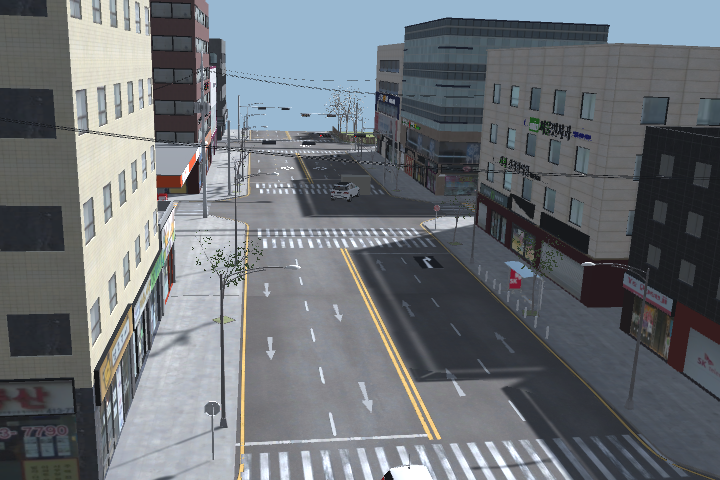
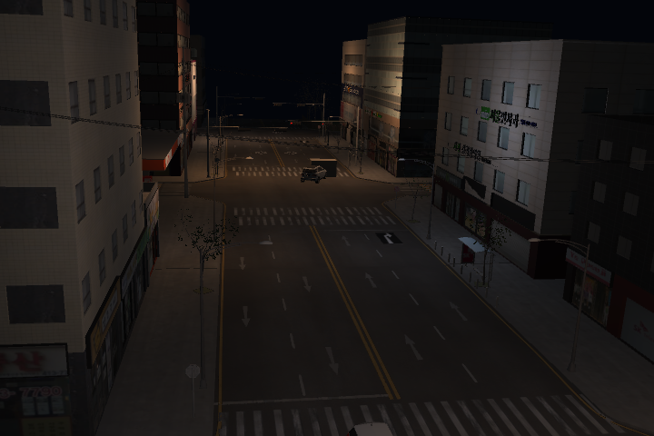
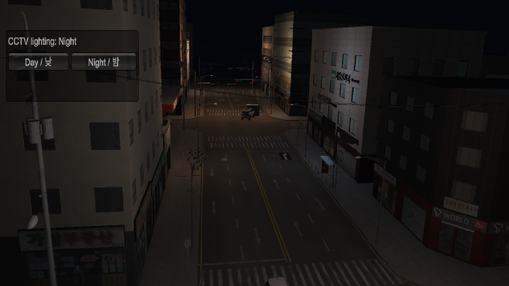
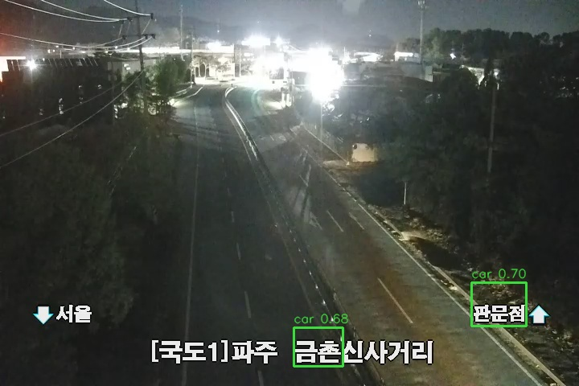

# 낮·밤 선택과 야간 합성 학습

기존 City Lab에 `DayNightEnvironment`를 추가했다. 도시·차량·신호등 에셋과 원본 도로 재질, 복원한 CCTV 좌표·화각을 사용한다.

## 가상환경에서 선택

1. Unity에서 CityTrafficLab 씬을 연다.
2. 기존 씬에 기능이 없으면 `TwinSight > City Lab > Install Day Night Controls`를 한 번 실행한다. 새 신호·사고 환경을 설치할 때도 함께 추가된다.
3. Play를 누른 뒤 화면 왼쪽의 `Day / 낮`, `Night / 밤` 버튼으로 바꾼다. `DayNightEnvironment`의 Inspector에서도 초기 `Time Of Day`를 선택할 수 있다.

낮에는 기존 태양·배경·환경광을 사용한다. 밤에는 태양광과 환경광을 낮추고 기존 보도 주변에 배치한 조명만 켠다. 도로·신호등 메시를 새로 만들거나 도로를 흰색으로 바꾸지 않는다. 기존 `CityLabExperiment`의 태양 밝기 설정이 밤 설정을 매 프레임 덮어쓰던 충돌도 해결했다. 이 환경 제어기가 켜져 있을 때 조명 제어는 이 컴포넌트가 담당한다.

`GroundTruthExporter`는 프레임마다 `lighting.time_of_day`, 조명 시드, 환경광·태양·가로등 강도를 정답 메타데이터에 기록한다. 야간 수집 준비 과정에서 태양광이 0.101을 넘는 자료는 거부한다. 초기 조명 충돌 자료는 제외 폴더에 보존하고 최종 학습에 사용하지 않았다.

| 낮 | 밤 |
| --- | --- |
|  |  |



## 데이터와 학습

야간 고정 CCTV 원본은 학습 160·검증 40·시험 40장이다. 각 분할은 다른 시드(29201/30302/31403)로 새 장면을 만들었다. 사람·차량·포트홀·낙하물·구조물 5종이며 가로등 색·세기와 주변 밝기도 바꿨다. 카메라 위치는 `(-17, 5.017182, 1.833129)`, 화각 약 38.015도로 유지했다.

| 데이터셋 | 학습 | 검증 | 시험 |
| --- | ---: | ---: | ---: |
| night-v1-full: 야간 원본 | 160 | 40 | 40 |
| night-v1-focus: 원본+원거리 확대 | 320 | 80 | 80 |
| day-night-v1: 기존 주간+야간 | 580 | 200 | 200 |

확대 영역은 기존과 같은 정규화 좌표 `(230/720,130/480,440/720,270/480)`다. 원본과 확대본은 같은 분할에 두었다. 위 표의 이미지 수는 서로 독립인 장면 수가 아니다. 기존 주간 보강 자료도 원래 분할을 유지했으며 픽셀 해시로 분할 간 완전 중복을 검사했다.

별도로 야간 신호 대기·밀집 대기·구조물 앞 정상 정차·추돌·구조물 충돌의 40개 연속 영상을 수집했다. 학습20/검증10/시험10, 영상당40프레임·5fps다. 경고 시험용 일반 정상 대기·포트홀·낙하물·추돌·구조물 충돌 5개 영상은 각90프레임이며 객체 검출 학습에 넣지 않는다. 수집한 정상·사고 영상과 정답을 런타임 경고 입력에 섞지 않는다.

검출기는 기존 `simulation-cctv-queue.pt`에서 주간·야간 혼합 데이터로 12epochs 추가 학습을 완료했다. CPU, imgsz640, batch4, freeze10, mosaic0.1, hsv_v0.25, seed22042를 사용했다. batch8 시도는 메모리 부족으로 중단하고 별도 폴더에 보존했다. 촬영 후 Editor를 종료하고 batch4로 새로 학습했다. 모델 선택은 검증 분할만 사용했다. 실제 CCTV 영상은 학습에 사용하지 않았다.

새 검출기 `detection/models/simulation-cctv-day-night.pt`의 SHA256은 `7dd2720a7bd8c8757c3a0f38b901b7e6dea46d68e97257916a6810b6947bf1a2`다. 이전 가중치는 보존했다.

별도 시험 분할에서 같은 원거리 확대 입력을 적용해 비교했다. 표는 IoU0.5의 101점 AP 기준이며, 뒤에 적은 검출·오탐 개수는 confidence0.25 기준이다. 실제 CCTV 정확도가 아니다.

| 시험 자료 | 기존 주간 모델 mAP50 | 주간·야간 모델 mAP50 |
| --- | ---: | ---: |
| 야간 합성 40장 | 0.9200 | 0.9943 |
| 기존 주간 합성 32장 | 0.9556 | 0.9512 |

야간 차량은 정답52개 중 48→51개 검출, 오탐9→3개였다. 보행자는 39/39개 검출을 유지하며 오탐35→1개, 포트홀6/8→7/8, 낙하물7/8→8/8, 구조물6/8→8/8로 바뀌었다. 주간 보행자는 30/31→29/31개로 소폭 감소했다. 주간 성능이 전 항목 개선됐다고 해석하지 않는다. [전체 비교](validation/day-night-v1/detection-comparison.json)에 클래스별 수치를 보관했다.

실행 결과는 `runs/night-v1/training-complete.json`, `evaluation/comparison.json`, `temporal-combined/verification.json`, `warning-checks/`, `evaluation/real-night-after/summary.json`에 기록한다. 검출 결과만 보고 실제 정확도가 개선됐다고 해석하지 않으며, 합성 시험과 정답 없는 실제 CCTV 관찰을 구분한다. 가림을 포함할 수 있는 Unity 자동 박스, 같은 도시와 차량을 공유하는 실험이라는 한계가 있다.

## 사고 경고와 실제 영상의 한계

새 검출기에 맞춰 기존 RTrees의 25개 관측 특징을 재학습했다. 주간·야간 train40영상과 기존 주간 검출기의 **train 분할 특징만** 보강 자료로 사용했다. 같은 물리 장면의 검출기별 특징을 다른 관측으로 사용한 것이며 독립 영상 수를 늘려 주장하지 않는다. RF 깊이·최소 표본·클래스 가중치 30개 설정은 검증20영상으로 선택했다. 시험 영상은 선택에 사용하지 않았다.

최종 후보는 depth8/min_samples1/128trees, 임계0.6016625다. 검증20영상에서 사고8/8 경고와 정상대기12/12 경고0을 확인했다. 별도 시험은 다음과 같다.

| 신호 대기 구역 시험 | 사고 경고 | 정상 대기 경고 |
| --- | --- | --- |
| 주간: 사고4·정상6영상 | 4/4, 실제 접촉 이후 | 0건 |
| 야간: 사고4·정상6영상 | 3/4; 그중 1건은 접촉 약54ms 전 | 0건 |

야간 반대 방향 추돌1건은 미검출이다. 야간 반대 방향 구조물 충돌은 약54ms 먼저 경고해, **접촉 이후 경고**를 요구하는 엄격한 검사에서는 실패로 남겼다. 별도 일반 야간 시나리오에서도 구조물 충돌 경고 누락이 있다. 따라서 후속 분류기 `stop-zone-collision-day-night.xml`은 실험 후보이며 전체 통과나 실사용 완료로 표시하지 않았다. 모델 SHA256은 `37e3e1c0b2e4929628f2dba4d2f5b1218b2a8c1803be85027a5bd423a758ef69`다. [전체 사고 시험](validation/day-night-v1/stop-zone-verification.json), [검증 기준 선택](validation/day-night-v1/stop-zone-selection.json)을 확인할 수 있다.

보존한 실제 야간 CCTV600프레임·120초도 다시 추론했다. 기존 모델의 차량 누적 박스471개가 새 모델에서884개로 바뀌었으나 **중복과 오탐을 포함하며 정확도 향상을 뜻하지 않는다.** 새 모델은 포트홀2·낙하물1개의 불확실한 박스와 경고0건을 기록했다. 자막을 차량으로 검출하는 오탐과 강한 전조등 주변 누락이 남는다. 실제 정답 라벨이 없어 mAP나 사고 재현율을 계산하지 않았다. 실제 CCTV의 자막·노출·빛 번짐·노이즈를 반영한 자료와 정답 검수가 추가로 필요하다.



[실제 영상 결과](validation/day-night-v1/real-night-summary.json)와 함께 해석해야 한다. 이 검출기와 사고 분류기는 기존 가중치와 다른 파일로 보관했다.

## 재현

프로젝트 데이터·다운로드·작업용 임시파일은 모두 `D:\Capston disign` 아래에 둔다.

Unity Play 모드에서 `NightExperimentCapture`를 빈 객체에 붙이면 독립 야간 스틸, 신호 대기 영상, 경고 시험 영상이 순서대로 생성된다. 수집은 임시 Play 세션이므로 끝나면 Play를 종료한다. 학습용 스틸만 필요하면 `Capture Night Training Dataset (Play Mode)` 메뉴를 사용한다. 기존 데이터를 덮어쓰지 않도록 재실험 시 접두사·시드·출력 폴더를 새 버전으로 바꾼다.

```powershell
$env:TEMP = 'D:\Capston disign\tmp'
$env:TMP = $env:TEMP
$env:YOLO_CONFIG_DIR = 'D:\Capston disign\tools\ultralytics'
$env:TORCH_HOME = 'D:\Capston disign\tools\torch-cache'
.\.venv\Scripts\python.exe -X utf8 -u -m detection.run_night_training --epochs 12 --batch 4
.\.venv\Scripts\python.exe -X utf8 -u -m detection.run_night_evaluation
```

후속 평가 실행기는 주간·야간 특징 수집, 검증 분할에 의한 RF 선택과 기존 train 특징 보강을 차례로 실행한다. 기존 완료 결과가 있으면 같은 자료의 추론을 반복하지 않는다. 선택 방법은 `detection/tune_night_temporal.py`에 있다.

새로운 출력 폴더를 쓰는 것이 기본이다. `--reuse-prepared`는 같은 촬영 세션·분할임을 확인하고 메모리 실패 후 이미 준비한 데이터를 재사용하는 옵션이다. 서로 다른 학습 실행을 무조건 이어 붙이지 않는다.

## DB 원본 보관

팀원 카탈로그와 같은 DB·앱 역할을 사용한다. 이번 야간 실험은 카탈로그의 라벨·결과뿐 아니라 **원본 파일의 실제 바이트도 PostgreSQL Large Object에 보관**한다. 앞선 DB 등록에서 경로만 저장했던 자료와 구분한다. 파일 서버·새 테이블·공개 권한은 추가하지 않는다. 사용한 SQL 파일 저장 함수는 [PostgreSQL 공식 문서](https://www.postgresql.org/docs/current/lo-funcs.html)에 정의돼 있다.

경로·크기·SHA256을 담은 `artifact-index.json`과 파일 내용을 묶는다. 내용이 같은 파일은 한 번 저장하고 인덱스에서 각 원본 경로로 연결하며, 연속 프레임은 ZIP을 XZ로 다시 압축한다. 이미지 재인코딩·해상도 축소 없이 원본 바이트를 유지한다. 카탈로그 기록의 `details.large_object_oid`와 `archive_sha256`으로 찾는다. 이 파일은 Supabase Storage 공개 URL이 아니며, DB 앱 역할로 복원한다. DB 용량을 사용하므로 큰 규모의 장기 수집에는 별도 Storage 운영이 적합하다.

등록·복원 스크립트는 [store_catalog_archive.py](../backend/scripts/store_catalog_archive.py), 이번 실험의 메타데이터 준비는 [register_night_experiment.py](../backend/scripts/register_night_experiment.py)다. 연결 정보는 Git 제외 `.env.database`에서 읽는다. 비밀번호를 명령행이나 문서에 넣지 않는다.

원본·학습 자료 7,992개는 318,306,328바이트의 무손실 압축본으로 DB에 저장했다. 기록 ID는 `night-v1-binary-archive-a1c5db40f6f2a3e1b295a1cd`다. 새 연결에서 압축본 전체 해시를 확인하고, D드라이브로 실제 내려받아 7,992개 원본 파일을 모두 추출·검증했다. [저장 증빙](validation/day-night-v1/sources-db-report.json), [복원 증빙](validation/day-night-v1/source-restore-report.json)을 보관했다. 학습 후 가중치·로그·추론·평가 파일은 후속 산출물 압축본으로 추가 등록한다.

```powershell
.\.venv\Scripts\python.exe -X utf8 backend/scripts/store_catalog_archive.py download --record-id <카탈로그의-archive-record-id> --archive 'D:/Capston disign/restored/night-archive.zip.xz' --extract-dir 'D:/Capston disign/restored/night-files'
```

복원 대상 ZIP/XZ 파일과 추출 폴더는 새 경로를 지정한다. DB에서 읽은 전체 압축파일과 내부의 모든 원본 파일을 해시로 검사한 뒤 성공으로 처리한다. D드라이브의 작업 원본도 보존한다.

현재 PC의 Python 실행기 `D:\Capston disign\tools\Run-ProjectPython.ps1`은 시작 위치도 프로젝트 D 경로로 고정한다. 기존에 옮긴 C 원본7개가 남아 있지 않은 것을 재확인했고 C의 빈 프로젝트 폴더도 삭제했다. 새 수집·학습·복원·임시 파일은 D에 있으며, 설치된 공용 앱 파일은 프로젝트 데이터 정리 대상에 포함하지 않았다.
