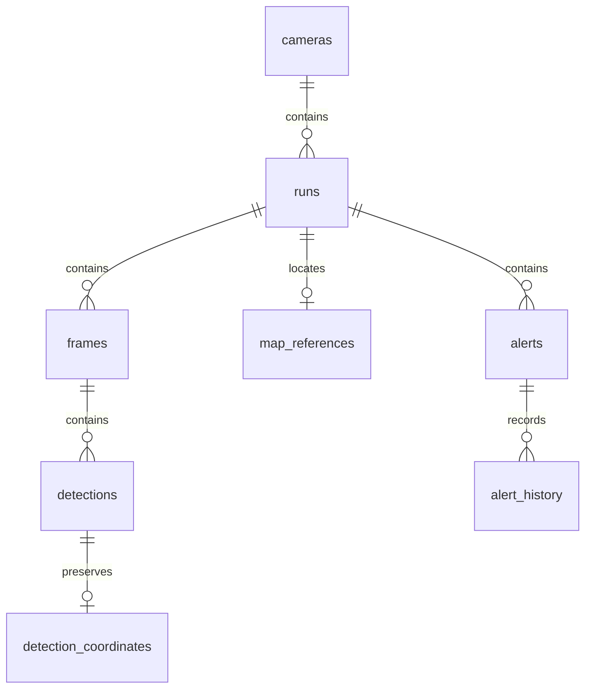

# 이상민 담당: 지도 시각화·데이터베이스

## Supabase DB 구축 결과 (2026-10-21)

담당 범위는 DB와 지도 시각화입니다. Render 배포, SSH 구축, 대시보드 로그인은 인계 대상 DB 기능의 필수 요소가 아닙니다.

- 프로젝트: `twinsight` / `lwgxgxemediqlhilnmlz`
- 지역: `ap-southeast-2` (Sydney)
- DB: PostgreSQL 17 / 데이터베이스 이름 `postgres` / 앱 스키마 `twinsight`
- [Table Editor](https://supabase.com/dashboard/project/lwgxgxemediqlhilnmlz/editor)에서 스키마를 `public` 대신 **twinsight**로 선택합니다.
- 기존 ORM 구조에 맞춰 12개 테이블을 생성했습니다. 초기 구조는 [SQL](../deploy/twinsight_schema.sql)에 보관하며, 이미 적용됐으므로 다시 실행하지 않습니다.
- 실제 카메라/검출/위험 데이터는 아직 없습니다. 원래 PC의 서버·DB 연결을 Supabase로 전환하지 않았습니다.

| 테이블 | 내용 |
| --- | --- |
| cameras | 카메라 ID, 이름, 위경도, 스트림 정보 |
| runs | 카메라별 분석 실행 및 시간 기준 |
| frames | 실행별 프레임 |
| detections | 객체, 추적 ID, 박스, 우선 적용한 노면 좌표 |
| detection_coordinates | 보정 전/후 좌표 보존 |
| map_references | 실행별 ENU 원점 위경도 |
| alerts | 위험 경고 |
| alert_history | 경고 처리 변경 이력 |
| catalog_records / catalog_files / catalog_logs / catalog_parents | 모델·학습·매핑 산출물 메타데이터 및 관계 |

검증: 임시 트랜잭션에서 카메라→실행→프레임→검출→원본/보정 좌표→지도 기준의 조인과 한글 저장을 확인했습니다. 잘못된 외래 키와 중복 프레임이 거절되는지 확인하고 전체 롤백했습니다. 실제 저장 레코드로 시연 데이터를 남기지 않았습니다.

보안: 12개 테이블 모두 RLS를 활성화하고 `anon`, `authenticated`, `PUBLIC`의 스키마/테이블/시퀀스 접근을 차단했습니다. 서버 전용 그룹 `twinsight_backend`는 로그인·RLS 우회·DDL 권한 없이 기존 테이블 CRUD와 시퀀스 사용만 허용합니다. 이 그룹의 RLS 정책은 모든 프로젝트 행을 허용하므로 신뢰하는 백엔드 계정에만 부여합니다. 브라우저 사용자에게 부여하면 안 됩니다. 자동-RLS 함수의 불필요한 직접 호출 권한도 제한했습니다.

### 추가 보완과 리뷰

- 1차 리뷰: 런타임의 스키마 생성 권한 의존성을 제거했습니다. `DATABASE_AUTO_CREATE=false`에서는 테이블/컬럼 존재만 검사하며, 누락 시 마이그레이션 안내 오류를 냅니다. 타입·제약조건 전체 동기화 기능은 아닙니다.
- 프레임 번호/크기, 지도 원점 위경도, 경고 상태에 DB CHECK 제약을 추가했습니다. 카메라별 경고 이력과 실행별 최근 프레임용 복합 인덱스를 추가했습니다.
- 새 프로젝트의 빈 DB에만 초기 SQL → 런타임 역할 SQL 순으로 한 번 적용합니다. 현재 프로젝트에는 이미 적용되었습니다. `restrict_rls_trigger.sql`은 `public.rls_auto_enable()`이 있는 Supabase 프로젝트에서만 사용합니다. 앞으로의 변경은 별도 마이그레이션으로 관리합니다.
- 로컬 PostgreSQL 격리 스키마에서 배포 SQL을 직접 적용하고, 소유자가 아닌 역할의 ORM CRUD/시퀀스 사용과 DDL 차단, 외래 키·CHECK 위반 차단을 검증합니다. 테스트는 실제 `twinsight` 스키마를 사용하지 않습니다.
- 2차 리뷰: 커밋 대상 파일만 추출한 별도 사본에서 PostgreSQL 통합 테스트를 포함한 백엔드 테스트 **62개 통과**. 기존 테스트 도구의 httpx 사용 중단 예정 경고 1개가 남습니다. 비밀번호·실제 연결 URL·대시보드/SSH 변경은 커밋에서 제외했습니다.
- 원격 Supabase에서 12개 RLS/서버 정책, 브라우저 접근 차단, DDL 권한 없음, CHECK 3개를 확인했습니다. MCP 연결 계정은 `SET ROLE` 권한이 없어 원격 서버 역할 CRUD 검증은 수행하지 못했습니다. 실제 로그인 계정으로의 연결 검증은 인계 시 필요합니다.
- 보안 Advisor 항목은 0개입니다. 성능 Advisor의 미사용 인덱스 INFO 13개는 실제 트래픽이 없는 초기 상태입니다. [공식 설명](https://supabase.com/docs/guides/database/database-linter?lint=0005_unused_index)

### 백엔드 담당자 인계

1. Supabase 프로젝트 **Connect → Session pooler**의 실제 연결 정보를 확인합니다. host/username은 화면 값을 사용하며 지역 이름으로 추측하지 않습니다. 비밀번호는 안전한 경로로 전달하고 Git이나 프론트엔드에 넣지 않습니다.
2. SQLAlchemy + psycopg 3으로 연결합니다. 연결 URL은 `postgresql+psycopg://.../postgres?sslmode=require` 형식입니다. 비밀번호의 URL 예약 문자는 인코딩합니다. Supabase publishable/service-role API 키는 DB 비밀번호가 아닙니다.
3. 이 작업 폴더의 `backend/app/db.py`는 `DATABASE_SCHEMA=twinsight`를 `schema_translate_map`으로 적용합니다. 원격 `main`에는 이 변경이 아직 없으므로 환경 변수만 추가해서는 충분하지 않습니다. 담당자가 DB 스키마 지정과 psycopg 의존성을 자신의 백엔드에 반영해야 합니다.
4. [.env.supabase.example](../.env.supabase.example)을 참고하여 `DATABASE_AUTO_CREATE=false`를 설정합니다. 실제 앱 LOGIN 계정/비밀번호는 아직 발급하지 않았습니다. DB 관리자가 별도의 `LOGIN INHERIT` 계정을 안전하게 생성하고 `GRANT twinsight_backend TO <앱계정>;`을 실행한 뒤, 해당 계정의 실제 Session pooler 접속 가능 여부를 확인합니다. 그룹 `twinsight_backend` 자체는 NOLOGIN이므로 접속 사용자 이름으로 사용하지 않습니다. 관리용 `postgres` 비밀번호를 앱에 배포하지 않습니다.
5. 앱에서 카메라 저장·검출 저장·경로 조회를 실행해 end-to-end 연결을 검증합니다. 현재 완료된 것은 Supabase DB 자체 구성과 SQL 검증이며 실제 팀 백엔드 연결은 남아 있습니다.

지도 시각화 인계 규약은 아래 API 및 좌표 설명을 사용합니다. 이 규약은 구현되어 있는 DB 브랜치 기준이며 최신 main의 React에 통합하는 작업과는 별개입니다.

---

2026-10-19 구현. README 역할표의 위험 위치·이동 경로 표시와 CCTV·객체·위험 이력 저장 범위입니다. 기존 백엔드·프론트엔드에 연동 기능을 추가하며 검출·추적·Homography 알고리즘은 재사용합니다.

## 저장 구조와 호환성



- 한 `run_id`는 한 카메라·한 시간 기준에 고정됩니다. 충돌하는 입력은 409이며 배열 요청은 전부 롤백합니다. 카메라마다 별도 run_id를 사용하세요. 실행 번호를 재사용하면 기존 `(run_id, frame_no)`가 교체되므로 새 수집에는 새 ID가 필요합니다.
- 경로 식별자는 `(run_id, model_id, track_id)`입니다. null track_id는 개별 점으로 표시하며 연결하지 않습니다. 시각이 역행하거나 관측 사이가 2초를 초과하면 화면의 선을 끊습니다. 이는 표시 규칙이며 추적 알고리즘의 재식별을 보장하지 않습니다.
- 기존 `detections.mapped_x/z`와 최신 프레임 API는 보정 우선 규약을 유지합니다. `detection_coordinates`는 원본/보정 두 쌍을 저장합니다. 프레임 교체 시 외래 키 CASCADE로 이전 좌표 부속 행도 제거합니다.
- 기존 DB의 원본 좌표는 이미 손실되었으므로 이력 API의 `coordinate_provenance=legacy_preferred_only`로 구분합니다. 신규 수집은 `preserved`입니다.
- `alert_history`는 상태·처리자 변경 전후와 변경 시각을 같은 트랜잭션에 남깁니다. 동일 값 재요청과 빈 PATCH는 감사 이력을 중복 생성하지 않습니다. 감사 이력은 변경부터 기록하며, 과거 처리 이력은 소급 생성하지 않습니다.
- 로컬 개발 모드(`DATABASE_AUTO_CREATE=true`)의 앱 시작 시 새 테이블 3개와 `ix_map_runs_camera_started`, `ix_map_alerts_run_timestamp` 인덱스를 멱등적으로 추가합니다. 기존 테이블의 컬럼 변경·삭제는 없습니다. 기존 SQLite에 새 테이블이 없는 상황에서 데이터를 보존하는 업그레이드 테스트를 포함합니다.
- 적용 전 앱을 멈추고 DB 파일을 백업하세요. PostgreSQL/MySQL 드라이버·이관·동시성 부하·장기 보관 정책은 운영 검증하지 않았습니다. 데이터를 자동 삭제하지 않습니다.

## API

| 메서드 | 경로 | 용도 |
| --- | --- | --- |
| GET | `/runs?camera_id=&offset=0&limit=100` | 실행 목록, `items`와 `next_offset` |
| GET | `/runs/{run_id}/frames?after_frame=-1&limit=100` | 프레임 번호 오름차순 이력, `items`와 `next_after_frame` |
| PUT | `/runs/{run_id}/map-reference` | 존재하는 실행의 ENU 기준 등록 |
| GET | `/runs/{run_id}/map?frame_limit=200&alert_limit=100` | 경로·추적 없는 점·경고·위치 근거 |
| GET | `/alerts/{id}/history?after_id=0&limit=100` | 상태/처리자 변경 이력, `items`와 `next_after_id` |

모든 limit은 1~1000입니다. 커서가 null이면 마지막 페이지입니다. 실행 목록 offset은 새 실행이 생기면 이동할 수 있으므로 소비자가 run_id로 중복을 제거해야 합니다. 프레임 조회는 수집 중 스냅샷이 아니며 뒤늦게 들어온 낮은 번호 프레임은 다시 조회해야 합니다.

지도 API는 최신 프레임 번호 N개와 최신 이벤트 시각 경고 M개를 각각 제한합니다. `frames_truncated`/`alerts_truncated`로 제한 여부를 표시합니다. 전체 검출 다운로드는 프레임 이력 API를 이용합니다. 경고는 기존 `/alerts`의 run_id/시각 필터로 조회하며 지도용 제한과 별개입니다. 경고의 동일 프레임 검출은 표시 범위 밖이어도 별도 조회합니다.

`tracks[].points`에는 `frame`, `timestamp`, `xz`, `latlon`이 있습니다. `risks[]`에는 기존 `alert`, `locations`, `location_basis`가 있습니다. 같은 실행·프레임·모델·추적 ID(클래스가 주어지면 클래스도 일치)가 유일하게 매칭될 때만 위치를 제공합니다. 누락/모호한 근거는 `unlocated`, 위치 배열은 비웁니다. 현재 객체 위치나 CCTV 설치 위치로 대체하지 않습니다. 프레임을 재수신해 교체하면 경고의 위치 연결도 교체된 프레임을 따릅니다.

## 실제 CCTV 좌표 연결

`mapping/twinsight_mapping/calibration.py`의 `latlon_to_local_xz`와 같은 WGS84 곡률 반경을 이용한 역변환입니다. **x=동쪽(m), z=북쪽(m)**이어야 합니다. 원점 반경 5km를 넘는 좌표는 근거리 근사 범위 밖으로 보고 latlon을 반환하지 않습니다.

1. 실제 검출 결과를 새 run_id로 수집합니다.
2. 해당 수집에 실제로 적용된 calibration JSON의 camera_id, `units=m`, `coordinate_system=local_enu...`, `origin_latlon=[위도, 경도]`를 확인합니다.
3. 확인한 값을 아래처럼 등록합니다. 원점 예시는 합성 시연용이며 실제 CCTV에 복사하면 안 됩니다.

```http
PUT /runs/<run_id>/map-reference
Content-Type: application/json

{"coordinate_system":"local_enu","units":"m","origin_lat":37.5665,"origin_lon":126.9780}
```

등록은 같은 값으로 재요청할 수 있습니다. 다른 원점으로 변경은 409입니다. 카메라/PTZ/캘리브레이션이 바뀌면 새 실행으로 수집하세요. API는 숫자 범위와 선언된 좌표계를 검사하지만 실제 측량 검증을 대신하지 않습니다. Unity, user, TM/UTM 좌표를 ENU라고 등록하지 마세요. 기준 미등록일 때 지역 좌표 SVG를 제공하고 단위는 미등록이라고 표시합니다.

## 시연 및 검증

```powershell
.\.venv\Scripts\python.exe -m uvicorn backend.app.main:app --reload
# 별도 터미널
.\.venv\Scripts\python.exe -m http.server 5173
# 별도 터미널
.\.venv\Scripts\python.exe backend\scripts\seed_map_demo.py
.\.venv\Scripts\python.exe -m pytest backend\tests -q
node --check frontend/map.js
node --check frontend/app.js
```

`http://localhost:5173/frontend/`에서 `지도 시연 (합성 데이터)`를 선택합니다. 합성 30프레임, 차량/포트홀 경로 2개, 포트홀 경고 1개가 표시됩니다. 실제 ITS 호출이나 영상 모델은 사용하지 않습니다. 실행할 때마다 새로운 시연 run_id를 만듭니다.

1차 검토: 실행 범위·좌표 보존·이력 조회·지도 표시 구현 및 API 회귀 테스트.

2차 검토: 혼합 카메라 요청 롤백, 시간 기준 충돌, 모델별 ID 중복, 미추적 객체, 늦게 도착한 경고 근거, 이전 DB 업그레이드, 비동기 카메라 전환, 기각 필터, 좁은 화면 스크롤을 확인했습니다. 위치 매칭은 단일 프레임의 근거 위치이며 사고 지점 확정 알고리즘은 아닙니다.

기술 참고: [Leaflet 공식 시작 안내](https://leafletjs.com/examples/quick-start/). 배경 지도와 라이브러리 CDN은 네트워크가 필요합니다. Leaflet 로드 실패 시에도 지역 좌표/이력 화면은 유지합니다. OpenStreetMap 출처는 지도에 표시합니다.

실제 CCTV 측량 기준과 실제 mapped_xz 입력은 저장소에 준비되어 있지 않아 현장 위치 정확도 검증은 남아 있습니다. 이번 검증은 합성 자료·API·브라우저 동작 검증입니다. Unity/LFS 모델 에셋은 지도·DB 변경 대상에 포함하지 않았습니다.

최종 결과: 백엔드 테스트 **35개 통과**, JavaScript 파일 2개 문법 검사 통과. 브라우저에서 30프레임·경로 2개 표시, 경고 기각/기각 포함 필터와 WebSocket 재접속을 확인했습니다. 테스트 도구가 httpx 관련 deprecation warning 1개를 출력했지만 실패는 없었습니다.

[파일 점검 목록](validation/map-database-file-scan.json)은 해당 시점 프로젝트 파일 1,011개를 기록합니다. 텍스트 189개는 전체 텍스트를 자동 스캔하고 Python은 구문 분석했으며, 담당 영역과 연동 코드는 내용 검토를 수행했습니다. 모델·이미지 등 에셋 822개는 메타데이터 목록 점검이며 모든 바이너리를 의미적으로 검토했다는 뜻이 아닙니다. Git/LFS 복제가 병행 중이어서 에셋 목록은 변할 수 있습니다.


초기 지도 검증은 `DATABASE_URL=sqlite:///backend/data/map-review.db`로 실행했습니다. 현재 기본 서버는 PostgreSQL로 전환되었습니다([DB 안내](postgresql.md)). SQLite 시연 자료는 이관하지 않았으며, 당시 검증 화면의 위험은 실제 도로 위험이 아닙니다.
