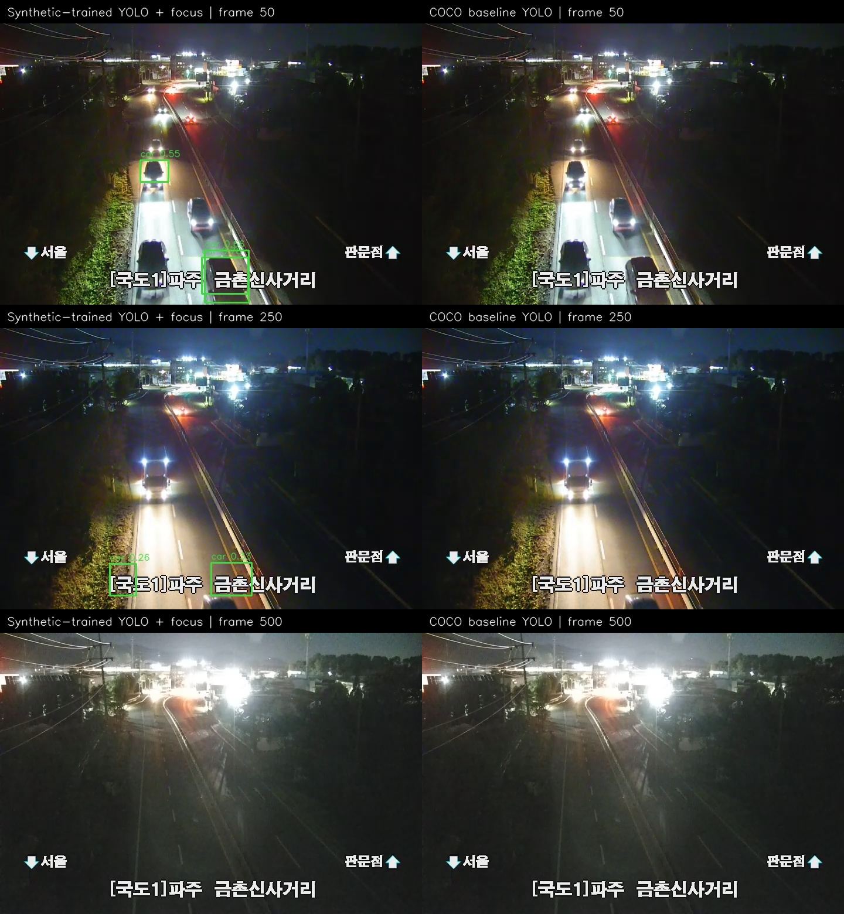
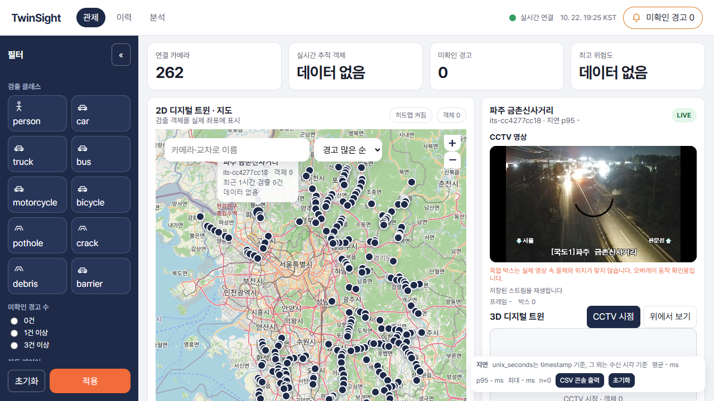

# 실제 CCTV 검증 — 2026-10-22

현재 모델은 실제 CCTV에서 추가 개선이 필요하다. 대시보드 연결과 검출 결과 전달은 확인했지만, 자막 오탐·야간 차량 누락·재생 버퍼링이 남아 있다. 사고 탐지 성능을 검증 완료했다고 보지 않는다.

## 연결과 자료

팀원 관제 화면의 최신 main `9a43f5e`를 `D:\Capston disign\reviews\dashboard-9a43f5e`에 내려받아 실행했다. 기존 수정 파일을 덮어쓰지 않았다. 프론트엔드 `http://localhost:5173`, 백엔드 `http://localhost:8000`이며, 평가용 SQLite를 별도로 사용했다. 목업 재생을 실행하지 않았고 `VITE_DEMO_TWIN=0`으로 설정했다. 화면에 남은 목업 안내 문구는 팀원 원본 UI의 고정 문구다.

처음 제공된 ITS 키는 마지막 글자가 빠져 인증에 실패했다. 수정된 키를 로컬 `.env`의 `ITS_API_KEY`로 저장한 뒤 금촌신사거리(`its-cc4277cc18`) API 인증과 스트림 주소 수신에 성공했다. 사용자가 보낸 `TS_API_KEY`는 백엔드가 읽는 `ITS_API_KEY`로 맞췄다. 키와 서명된 영상 주소는 이 문서나 Git에 포함하지 않는다.

실제 야간 HLS의 연속 세그먼트 8개를 받았다. 원본 720×480, 30fps의 3,595프레임에서 600장을 골랐다. 원본 MPEG-TS PTS 기준 약120초, 최대 표본 간격0.3334초, 샘플 이미지600개가 모두 서로 다르다. 네트워크 수신 시각을 영상 시간으로 쓰지 않았다. 처음 OpenCV 직접 수집한 103장은 수신 간격이 불안정해 연속 경고 평가에서 제외했다. 별도로 팀원 `feat/vehicle-assets`의 실제 주간 이미지16장도 확인했다. 이 자료들은 학습에 넣지 않았다.

## 모델 결과

합성 추가 학습 모델은 `simulation-cctv-queue.pt`와 기존 원거리 확대 설정을 그대로 사용했다. 비교용은 COCO 사전학습 `yolo11n.pt`의 전체 화면 실행이다. confidence0.25, imgsz640, CPU이며 설정이 다르므로 가중치만의 공정 비교도 아니다.

| 실제 야간 600프레임 | 합성 학습+원거리 확대 | COCO 전체 화면 |
| --- | ---: | ---: |
| 차량 박스 누적 관측 | 471 | 45 |
| 포트홀 박스 누적 관측 | 3 | 지원하지 않음 |
| 생성한 경고 | 0 | 0 |
| 첫 프레임 제외 평균 추론 | 약123ms | 약66ms |

표의 박스 수는 같은 차량의 반복 관측과 오탐을 포함한다. 차량 수·정확도·재현율을 뜻하지 않는다. 정답 박스가 없으므로 mAP나 정확도는 계산하지 않았다. 합성 모델이 더 정확하다고 결론내리지 않는다.

- frame250 등에서 화면 하단의 카메라 자막을 차량으로 잘못 검출했다.
- 대표 frame50/250/500에서 야간 눈부심과 작은 차량의 누락이 보인다. 두 설정 모두 개선이 필요하다.
- frame386~388의 작은 포트홀 예측은 실제 포트홀로 확인하지 못했다. 약0.41 수준의 낮은 신뢰도이며 경고 기준을 충족하지 않았다.
- 경고0건은 이 영상에서 엔진이 경고를 만들지 않았다는 뜻이다. 사고 정답 영상이 없어 추돌·낙하물·구조물 충돌의 실제 탐지율은 평가하지 못했다.
- 실제 카메라용 OpenCV 도로 보정 자료를 재사용했다. 이 자료의 `stop_zones`는 비어 있으므로 Unity용 신호 대기 구역을 억지로 적용하지 않았다. 신호 대기 사고 분류기의 실제 CCTV 성능은 아직 미검증이다.

## 대시보드 확인

실제 CCTV 영상 프레임이720×480으로 연결되는 것을 확인했다. 다만 브라우저의 재생 시각이 두 차례885.515956초로 멈춰 있어 안정 재생은 통과로 판정하지 않았다. 새 인증 성공과 지속적인 영상 재생은 별도 문제다.

모델이 만든 실제 CCTV frame50의3개 박스를 팀원 `/ingest/detections`에 평가 run으로 보냈다. HTTP200, 최신 프레임 조회의 frame50/3개 박스 일치, WebSocket `detections` 이벤트 수신까지 확인했다. 녹화 검출과 별도 HLS 플레이어의 시간 동기화는 확인하지 않았으므로 실시간 박스가 차량 위치에 정확히 맞는다고 주장하지 않는다. 3D 좌표 정확도도 이 검사 범위에 포함하지 않았다.

## 다음 작업

야간·주간 실제 영상에 정답 박스를 붙여 고정 평가 세트를 만들고, 자막 영역 마스킹과 야간·원거리 보강을 학습 자료에서 준비한다. 평가 영상에 맞춰 임계값을 바꾸거나 재학습하지 않는다. 사고·낙하물·포트홀은 별도 정답 사례가 필요하며, HLS 재연결과 영상/검출 프레임 동기화도 검증해야 한다.

모든 원본 영상·모델 결과는 `D:\Capston disign\Computer-vision\runs\real-cctv-20261022`에 있다. 공유용 기록에는 비밀값을 제외했다.

[수집 무결성](validation/real-cctv-20261022/capture.json) · [합성 모델](validation/real-cctv-20261022/synthetic-night.json) · [COCO 기준](validation/real-cctv-20261022/coco-night.json) · [화면 연결](validation/real-cctv-20261022/dashboard-integration.json) · [검수·한계](validation/real-cctv-20261022/review.json)
