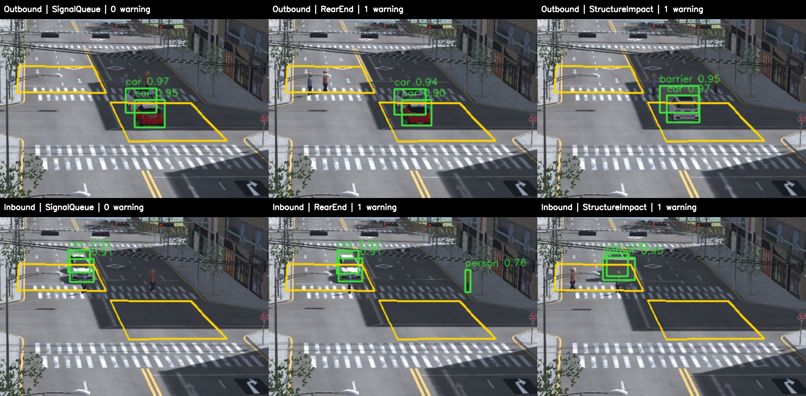

# 신호 대기 구역 내부 사고 학습

기존 City Lab과 금촌 기준 CCTV를 유지하고 대기 구역 내부에 추돌·구조물 충돌 장면을 추가했다. 정상 대기와 사고를 함께 학습한다. 기존 에셋 차량, 신호등, 도로, `WaypointMover`, `TrafficVehicleAgent`, `GroundTruthExporter`, ByteTrack을 재사용한다.

## 시나리오와 촬영

| 장면 | 동작 |
| --- | --- |
| SignalQueue | 적색 신호에서 정지선 앞 대기 |
| TightQueue | 짧은 간격으로 접근하지만 앞차에 닿지 않고 정지 |
| BarrierStop | 구조물 앞에서 여유 간격을 두고 안전 정지 |
| RearEnd | 대기 차량을 뒤차가 실제 물리 접촉으로 추돌 |
| StructureImpact | 대기 구역 안의 구조물에 차량이 실제 물리 접촉 |

양방향으로 train 20개, val 10개, test 10개의 독립 장면을 촬영했다. 각 장면은 1440×960, 5fps, 40프레임이다. 서로 다른 시드 11401/12502/13603을 사용하며 같은 영상의 인접 프레임을 train/test로 나누지 않는다. 학습용 사고 라벨은 `physics_contact`가 확인된 경우에만 만들고, 검출 박스를 실제 충돌 참여 객체에 맞춘다. 정상 대조는 실제 차량·구조물 사이의 남은 간격도 확인한다.

Unity에서 Play 후 **TwinSight → City Lab → Capture Stop Zone Training and Checks (Play Mode)**로 다시 수집할 수 있다. 저장 폴더는 `TwinSightExport/queue-v2-*`이다. 메뉴는 수동 카메라 렌더를 사용하므로 Game 탭의 표시 상태에 의존하지 않는다. 카메라 준비가 끝나고 첫 프레임을 저장한 뒤 차량을 출발시켜 사고 전 접근 구간을 보존한다. 끝나면 Play를 중지한다.

일반 시뮬레이션에서도 차량·구조물 충돌 에피소드의 40%를 대기 구역에 생성한다(`stopZoneIncidentFraction`). Play에서 6/7 키는 한 방향의 추돌/구조물 충돌, 8/9 키는 반대 방향의 같은 상황을 실행한다. 수동 시험은 적색 신호를 유지하며 다음 일반 에피소드에서 신호 순환이 돌아온다. 원래 CCTV 좌표와 화각은 바꾸지 않는다.

## 학습과 판정

반대 차로에서는 뒤차의 지붕 일부만 보여 기존 모델이 두 차량을 하나로 합치는 경우가 있었다. 이 장면의 정답 박스로 YOLO를 8 epochs 추가 학습했다. 예전 포트홀·낙하물 등 사례도 함께 넣어 기존 검출을 유지한다. 영상마다 0/2/4/6/8/12/20/30 프레임을 고르고, 기존 자료를 섞어 train 260장, val/test 각 120장으로 구성했다. 원거리 영역은 기존과 동일하게 확대한다.

대기 구역 내부 판정에는 별도의 OpenCV RTrees 모델을 사용한다. 입력은 검출 박스의 겹침·상대 간격·이동·크기 변화 등 25개 값이다. 가림으로 바닥점이 보이지 않으면 지붕 쪽의 접근 후 정지도 확인한다. 약하게 검출된 차량의 추적 이력도 연결하지만, 경고 순간에는 두 객체가 모두 기준 신뢰도를 충족해야 한다.

사고 이벤트와 객체 정답은 학습 라벨과 별도 평가에만 사용한다. 경고를 생성할 때는 영상 검출과 과거 추적 이력만 읽는다. 분류 기준은 val 영상으로 정하고 test 영상은 최종 확인에 사용한다. RTrees 점수는 나무들의 양성 투표 비율이며 보정된 사고 확률은 아니다. 모델을 지정하지 않으면 기존의 보수적인 대기 구역 제외 동작을 유지한다.

```powershell
.\.venv\Scripts\python.exe -m detection.train_stop_collision collect --weights detection/models/simulation-cctv-queue.pt --out runs/queue-v3
.\.venv\Scripts\python.exe -m detection.train_stop_collision train --weights detection/models/simulation-cctv-queue.pt --out runs/queue-v3 --model detection/models/stop-zone-collision-final.xml
.\.venv\Scripts\python.exe -m detection.train_stop_collision verify --out runs/queue-v3 --model detection/models/stop-zone-collision-final.xml
```

```powershell
.\.venv\Scripts\python.exe -m detection predict --source "<Unity저장폴더>" --weights detection/models/simulation-cctv-queue.pt --focus "0.319444444,0.270833333,0.611111111,0.5625" --alerts --context detection/config/geumchon-city-lab.context.json --stop-model detection/models/stop-zone-collision-final.xml --save-images
```

`--stop-model`은 학습에 사용한 YOLO 가중치와 함께 사용한다. 실행기는 가중치 해시가 다른 경우 오류를 낸다. 카메라·도시·차량 외형을 공유하는 합성 실험이므로 실제 CCTV나 완전히 가려진 사고에 대한 성능 보장은 아니다.

## 완료 결과 (2026-10-21)

YOLO 8 epochs와 RTrees 128개 나무의 학습을 완료했다. RTrees는 train 영상에서 뽑은 171개 판정 사례(정상 107, 실제 접촉 64)로 학습했다. val 영상에서 정상 경고를 먼저 최소화하고 사고 검출을 높이는 기준으로 투표 임계값 0.51을 선택했다. 처음 임의로 둔 0.60에서는 가려진 구조물 충돌 val 1개가 누락되어, test 확인 전에 엄격한 과반수 범위에서 val 기준을 조정했다. test 영상은 가중치·기준 선택에 사용하지 않았다.

| 별도 test 영상 | 영상 수 | 결과 |
| --- | ---: | --- |
| 정상 신호 대기 | 2 | 경고 0건 |
| 좁은 간격 대기 | 2 | 경고 0건 |
| 구조물 앞 안전 정지 | 2 | 경고 0건 |
| 대기 차량 추돌 | 2 | 각 1건, 실제 접촉 후 경고 |
| 구역 내부 구조물 충돌 | 2 | 각 1건, 실제 접촉 후 경고 |

val에서도 사고 4/4개와 정상 6/6개가 같은 기준을 통과했다. train 결과는 사고 8/8개·정상 12/12개이나 이는 학습 자료 성능이다. 16개 물리 사고 모두 두 참여 객체의 접촉 당시 바닥 좌표가 OpenCV 대기 구역 안에 있음을 별도로 확인했다. 최종 test 경고 지연은 접촉 후 약 0.02~0.45초이며 5fps 촬영 기준이다.

최종 YOLO와 판정 모델을 함께 적용해 기존 5종 영상 450프레임도 재검사했다. 정상 0건, 포트홀 2건, 낙하물 2건, 추돌 1건, 구조물 충돌 1건을 유지했다. 위험물 2건은 기존 15초 재경고 주기다. Python 검출/경고 40개, 매핑 26개 검사도 통과했다.

로컬 모델은 `detection/models/simulation-cctv-queue.pt`와 `detection/models/stop-zone-collision-final.xml` 및 같은 이름의 `.json`을 함께 사용한다. 이전 가중치는 보존했다. 모델·원본 영상은 현재 로컬 학습 산출물이다. 재학습할 때는 기존 모델을 덮어쓰지 않도록 새 `--model`과 `--out` 경로를 지정한다.

[분리 영상 검증](validation/stop-zone-v2/verification.json) · [기존 5종 재검사](validation/stop-zone-v2/regression.json) · [학습 기록](validation/stop-zone-v2/training-report.json) · [모델 해시](validation/stop-zone-v2/model-hashes.json)

아래는 같은 CCTV의 원거리 영역을 확대해 보여 준 실제 검출 화면이다. 노란 테두리가 두 신호 대기 구역이며, 경고 수는 해당 영상 전체의 최종 판정 결과다.


