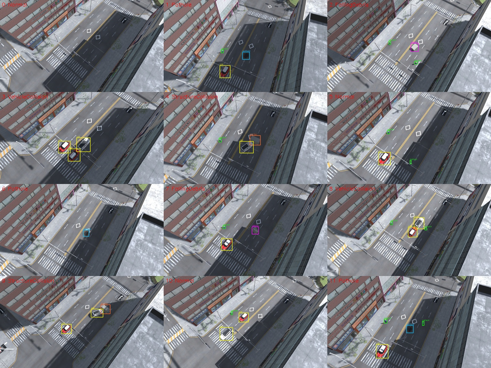
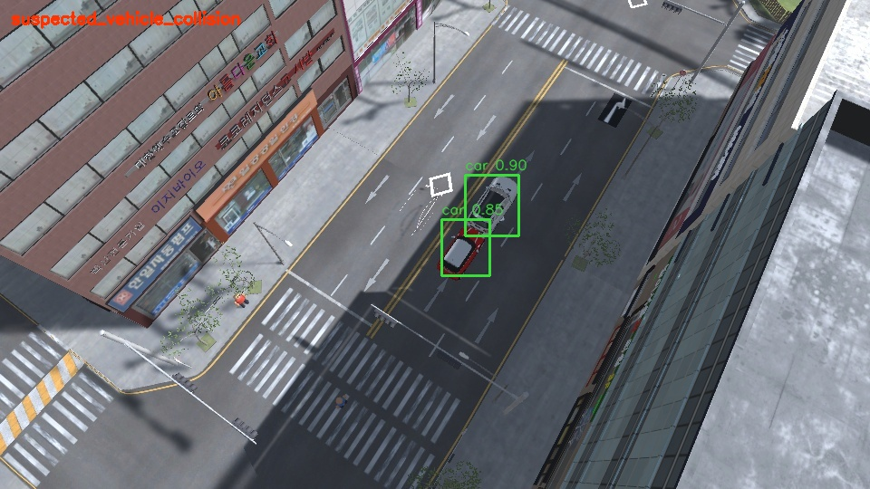

# 가상환경 추가 학습

> 현재 촬영 메뉴는 사진의 고정 CCTV 시점으로 변경됐습니다. 아래는 기존 overhead 실험 기록이며, 현재 실행 방법은 [고정 CCTV 학습](cctv_training.md)을 따릅니다.

이 학습은 기존 City Lab에서 만든 이미지와 Unity 객체의 정답 박스를 사용합니다. 공개 데이터와 ITS 영상은 이번 학습에 섞지 않습니다. 합성환경 검증과 실제 CCTV 성능은 구분합니다.

## 촬영

CityTrafficLab을 열고 Play한 뒤 **TwinSight → City Lab → Capture Varied Training Dataset (Play Mode)**를 실행합니다. 기본값은 train 160장(seed 2101), val 32장(3202), test 32장(4303)입니다. 저장 위치는 `simulation/TwinSightSim/TwinSightExport/synthetic-v2-*`입니다.

- 차량은 기존 SUV/Mini 프리팹, 보행자는 기존 절차적 모형을 사용합니다.
- 정상·포트홀·낙하물·차량 추돌·구조물 충돌 장면을 순환합니다. 충돌은 객체 검출용 차량/방호벽 라벨로 저장되며 `collision`이라는 새 검출 클래스를 학습하지 않습니다.
- 시점·화각·조명·위험물 크기와 배치, 차량 수, 보행자 위치·방향을 바꿉니다. 낙하물이 착지하고 실제 충돌이 일어난 뒤 촬영합니다.
- 정답이 없는 원본 주차 차량은 촬영 세션에서 숨기고, 생성한 차량·보행자에는 기존 `TrackedObject` 라벨을 사용합니다.
- 클래스는 `person, car, pothole, debris, barrier`입니다. 버스·트럭·균열 등은 이번 모델의 학습 대상이 아닙니다.
- 촬영이 끝나면 Play를 중지합니다. 임시 촬영 객체를 편집 씬에 저장하지 않습니다.

카메라가 매 이미지마다 변하는 학습 스틸입니다. `camera.json` 하나로 좌표 매핑/추적 성능을 평가하면 안 됩니다. 각 분할의 시점 기록은 Unity `Logs/synthetic-v2-<split>-poses.json`에 따로 저장합니다.

## 변환·학습

명령은 저장소 루트에서 실행합니다. 세션 폴더는 실제 촬영 결과 이름으로 바꿉니다.

```powershell
.\.venv\Scripts\python.exe -m detection prepare-unity --train "<train세션>" --val "<val세션>" --test "<test세션>" --classes person,car,pothole,debris,barrier --out datasets/synthetic-v2
.\.venv\Scripts\python.exe -m detection train --data datasets/synthetic-v2/dataset.yaml --weights yolo11n.pt --epochs 20 --imgsz 512 --batch 8 --device cpu --freeze 10 --mosaic 0.2 --name synthetic-v2
```

기존 COCO 가중치에서 전이 학습하며, 기존 기준 모델과 도로 위험 모델 파일은 보존합니다. 출력은 `runs/detection/train_<시각>/synthetic-v2/weights/best.pt`입니다.

## 비교와 경고 확인

```powershell
.\.venv\Scripts\python.exe -m detection.evaluate_detection --data datasets/synthetic-v2/dataset.yaml --weights detection/models/yolo11n.pt --road-weights detection/models/scenario-hazards.pt --out runs/synthetic-v2/baseline --imgsz 512
.\.venv\Scripts\python.exe -m detection.evaluate_detection --data datasets/synthetic-v2/dataset.yaml --weights "<새 best.pt>" --out runs/synthetic-v2/trained --imgsz 512
```

이 비교기는 클래스 번호가 다른 두 기준 모델의 결과도 이름으로 맞춥니다. IoU 0.5의 101점 AP와 confidence 0.25의 precision/recall을 동일한 test 이미지에서 계산합니다. test는 학습 및 최적 epoch 선택에 사용하지 않습니다.

경고는 별도 Play 세션에서 **Capture Warning Check Clips (Play Mode)**로 고정 CCTV 연속 영상을 촬영해 확인합니다. 정상 신호 대기·포트홀·낙하물·차량 추돌·구조물 충돌을 각각 45프레임/5fps로 저장합니다. 정상 대조 장면은 정지선을 볼 수 있도록 카메라를 옮깁니다.

```powershell
.\.venv\Scripts\python.exe -m detection predict --source "<고정 CCTV 저장세션>" --weights "<새 best.pt>" --imgsz 512 --alerts --save-images
```

이 도구의 정답은 검출 모델 학습·평가에 사용합니다. 경고 추론은 Unity 사고 이벤트를 읽지 않고 검출·추적 결과만 사용합니다.

## 해석 범위

분할은 서로 다른 시드와 장면 배치를 쓰지만 같은 도시·차량 외형을 공유합니다. 새로운 도시나 실제 CCTV에 일반화됐다는 평가가 아닙니다. 자동 박스는 가려진 부분을 포함할 수 있고 보행자 모형도 단순하므로, 학습용 라벨의 완전한 사람 검수를 완료했다고 표시하지 않습니다.

## 2026-10-20 실행 결과

20회 학습 완료(학습 루프 약 662초, CPU). 로컬 실행 모델은 `detection/models/simulation-detection.pt`이고 SHA-256은 `7c444f7f3b0dcb70185c594ffdb3e1ab4a805a3f76c23bc42167a95f2381742e`입니다. 기존 두 모델 파일은 보존했습니다. 새 모델의 5종을 한 번에 실행합니다.

```powershell
.\.venv\Scripts\python.exe -m detection predict --source "<Unity저장폴더>" --weights detection/models/simulation-detection.pt --imgsz 512 --alerts --save-images
```

| 동일 test 32장, confidence 0.25 | 기존 COCO+합성 위험물 모델 | 새 합성 모델 |
| --- | --- | --- |
| 차량 정답 40개 검출 | 2 | 40 |
| 보행자 정답 31개 검출 | 0 | 29 (오탐 9개) |
| 포트홀 정답 7개 검출 | 6 | 6 |
| 낙하물 정답 6개 검출 | 4 | 3 |
| 방호벽 정답 6개 검출 | 4 | 6 |
| 5종 mAP50, 101점 보간 | 0.474 | 0.985 |

AP는 신뢰도 순위를 전체 구간에서 평가하고, 위 검출 수는 confidence 0.25에서 센 값입니다. 낙하물의 AP가 높아져도 이 설정에서의 재현율은 0.5라 누락이 남습니다. 모든 종류가 개선됐다고 해석하지 않습니다. 새 카메라 구도의 정상 대조 영상에서는 차선 도색의 차량 오탐도 관찰했습니다. 시점·배경을 더 넓힌 추가 자료가 필요합니다.

고정 영상에서는 포트홀·낙하물·차량 추돌 의심·구조물 충돌 의심 경고를 각 1건 확인했고, 정상 신호 대기 대조 45프레임은 경고 0건입니다. 이는 이 5개 짧은 영상의 동작 확인입니다. 박스가 조금만 겹치는 후방 추돌을 위해 IoU 기준을 0.08에서 0.02로 조정했으며, 접근 후 급정지·지속 검출 조건과 정지 대기 영역 제외는 유지합니다. 물리 접촉 확정이 아닌 `unconfirmed` 경고입니다. 자동 검사 30개 통과.

검증 기록: [기존 모델](validation/synthetic-v2/baseline.json), [새 모델](validation/synthetic-v2/trained.json), [5개 연속 영상](validation/synthetic-v2/warning-clips.json), [경고](validation/synthetic-v2/alerts.jsonl).




