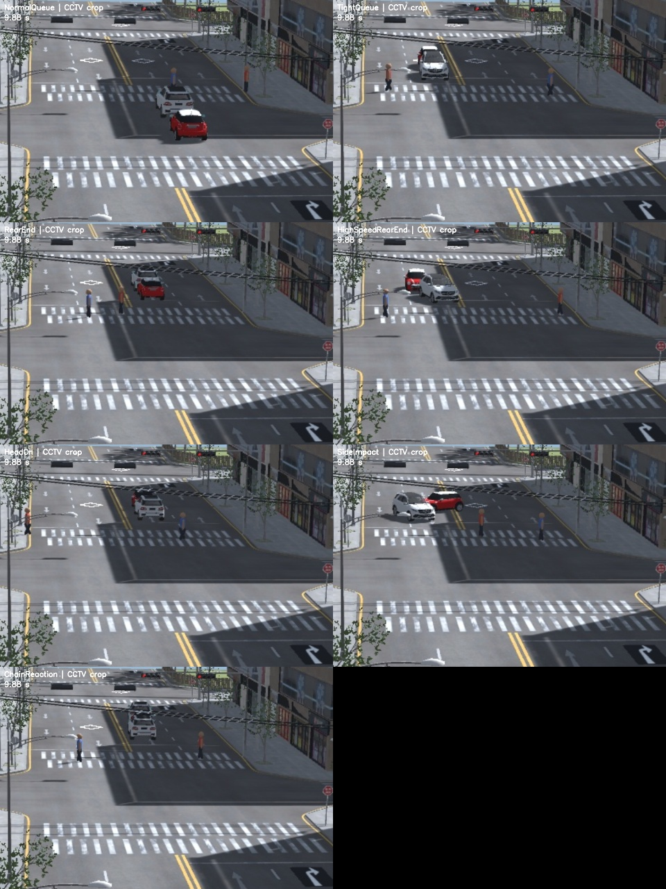

# 차량 충돌 장면 확장

## 장면과 조작

기존 도시·차량 에셋과 신호등, 도로 재질, 고정 CCTV를 재사용한다. `CityTrafficLab`을 Play한 뒤 Game 창에 초점을 두고 다음 키를 누른다.

| 키 | 장면 |
|---|---|
| F1 | 일반 후방 추돌 |
| F2 | 고속 후방 추돌·밀림·회전 |
| F3 | 양쪽 차량이 접근하는 정면충돌 |
| F4 | 비스듬히 진입하는 차량의 측면충돌 |
| F5 | 세 차량 연쇄 추돌 |
| F6 | 차량 간격을 둔 정상 신호 대기 |

기존 숫자1~9키도 유지한다. 일반 자동 실험의 차량 사고 에피소드에도 새 충돌 유형을 섞는다. 신호 대기 구역 사고는 기존 설정에 따라 계속 생성한다.

정상 차량의 기본 범퍼 간격은0.25에서0.75 Unity 단위로 늘렸다. 일반 신호 대기와 구조물 앞 정상 정지도 최소0.75를 사용한다. 도시와 차량을 축소한 좌표이므로 이 값을 실제 도로의 미터로 읽지 않는다. 데이터 수집 전용 `TightQueue`에는0.18 간격의 비접촉 대조 장면을 남긴다. **가까이 있다는 사실만으로 사고 정답을 만들지 않는다.**

새 충돌 차량은 실제 PhysX 접촉 후 추진을 끄고 운동량에 따른 밀림·평면 회전을 허용한다. 감쇠 후2초에 정지시킨다. 차량을 순간이동하거나 서로 관통시키는 방식으로 사고를 만들지 않는다. 고속 추돌의 설정 속도는 일반 추돌2.4 대비6.5 Unity 단위/초다. 실제 차량의 파손·변형·전복을 재현한 충돌 공학 모델은 아니다.

## 데이터 수집과 구분

Play 중 `TwinSight → City Lab → Capture Varied Collision Clips (Play Mode)` 메뉴를 실행한다. 수집은 일반 스포너와 자동 에피소드를 멈추므로 끝난 뒤 Play를 종료하고 다시 시작해 일반 실험으로 돌아간다.

- 다섯 사고와 두 비사고 대조를 낮·밤, train/val/test의 서로 다른 seed·방향·위치 조합으로 수집한다. 기본42클립, 각80프레임/8fps, 합계3,360프레임이다.
- 사고 전3초 이상의 정지·접근 준비 구간과 실제 접촉·충돌 후 장면을 포함한다. CCTV 위치·각도·화각은 바꾸지 않는다.
- 원본: `simulation/TwinSightSim/TwinSightExport/collision-v1`.
- 같은 수집을 다시 실행하면 기존 자료를 보존하고 그 아래 `run-...` 폴더를 새로 만든다. 이때 검사 명령의 `--exports`에는 새 폴더를 지정한다. 동시에 두 수집을 시작하거나 C드라이브를 지정하면 중단한다.
- 기존 GroundTruthExporter의 이미지·박스·신호·조명·카메라 정보에 더해, 각 클립에 `motion_audit.json`으로 위치·회전·속도와 실제 접촉 쌍을 기록한다. 최상위 `capture-audit.json`에 출처와 분할을 기록한다.
- 정답 사건은 `OnCollisionEnter`에서 기록한다. 상대 속도·접촉 위치·충격량은 오프라인 검수용이며, 모델 추론에는 전달하지 않는다.
- 자동 정답 박스에는 가림이 포함될 수 있다. 전체 라벨 사람 검수는 별도로 필요하다. 같은 도시·차량을 공유하는 합성 분할이므로 실제 도로 일반화를 보장하지 않는다.

프로젝트 루트에서 검사·YOLO 라벨 변환·미리보기를 생성한다. Python 실행기는 임시파일과 캐시도 D드라이브에 둔다.

```powershell
& 'D:\Capston disign\tools\Run-ProjectPython.ps1' -m detection.collision_scenes `
  --exports simulation/TwinSightSim/TwinSightExport/collision-v1 `
  --out runs/collision-v1 `
  --dataset datasets/collision-v1 `
  --previews
```

검사는 실제 접촉 여부·연쇄 접촉 횟수·사고 전 구간·정상 간격·사고 후 접촉 쌍 간격·시간 간격·조명·고정 카메라·이미지 누락을 확인한다. 실패한 수집본을 학습용으로 자동 채택하지 않는다. 이전 실험·모델과 실패한 시험 촬영은 보존한다.

충돌 단독 자료는 차량·보행자 위주의 **보강용**이다. 기존 다섯 객체 클래스의 이름과 ID를 유지한 채, 기존 낮·밤 자료와 새 원거리 확대 이미지를 합친다. 기존 `detection.prepare_focus`를 재사용한다.

```powershell
& 'D:\Capston disign\tools\Run-ProjectPython.ps1' -m detection.prepare_focus `
  --full-data datasets/day-night-v1/dataset.yaml `
  --detail-data datasets/collision-v1/dataset.yaml `
  --out datasets/day-night-collision-v1
```

최종 혼합본은4,340장(train1,700/val1,320/test1,320)이다. 모든 객체 클래스의 라벨과 이미지 중복에 의한 분할 누수 검사를 통과했다. 연속 영상에는 반복된 정차 프레임이 있으므로 후속 학습에서는 클립별 표본 수와 기존 위험물 클래스 비중을 조절해야 한다. 전체 라벨 사람 검수와 새 모델 학습은 이번 작업에서 수행하지 않았다.

## 인식 확인

장면을 추가하는 것과 모델을 재학습하는 것은 별도 단계다. YOLO의 `car` 박스 자체는 사고 판정이 아니다. 기존 경고 엔진은 두 차량의 검출·ID 유지·접근·접촉처럼 보이는 박스 겹침·급정지를 함께 요구한다. 가림, ID 변경, 큰 회전, 충돌 후 움직임이 길게 이어지는 사고는 누락될 수 있다.

같은 가중치를 고정하고 시험 분할만 아래 두 경로로 비교할 수 있다.

```powershell
& 'D:\Capston disign\tools\Run-ProjectPython.ps1' -m detection.collision_scenes `
  --exports simulation/TwinSightSim/TwinSightExport/collision-v1 `
  --out runs/collision-v1-check --evaluate
```

`unity-focus`는 기존 가상 CCTV용 원거리 확대 입력·도로/대기 구역·기존 RTrees를 사용한다. `lab-fullframe`은 수동 검증 대시보드처럼 전체 화면과 일반 경고 규칙을 쓴다. 두 경로는 처리 설정이 다르므로 모델 학습 성능의 전후 비교로 설명하지 않는다. 실제 CCTV에 Unity 좌표나 전용 RTrees를 가져다 적용하지 않는다.

경고는 실제 접촉 이후이며 올바른 두 객체를 가리키는지도 검사한다. 사고 클립 전체에 아무 경고 하나만 있으면 성공으로 세지 않는다. 정상 대조의 오경고도 함께 기록한다. 결과는 `inference/verification.json`에 있으며, 이 검사 자체가 재학습이나 실제 CCTV 정확도 평가를 수행하지는 않는다.

미리보기의 `*-focus.webm`은 차량이 잘 보이도록 CCTV 일부를 확대한 영상이다. 원본 영상·카메라 좌표는 보존한다. [수동 검증 화면](manual_validation_lab.md)에 이 파일을 넣어 구간 검사와 경고를 확인할 수 있다.

## 2026-10-25 확인 결과

- 수집42클립/3,360프레임 모두 장면 검사를 통과했다. 실제 차량 사고30클립, 비사고12클립이며 연쇄 추돌을 포함해36개 접촉 쌍이 기록됐다. 정상 기본 간격은0.75, 사고 후 실제 접촉 쌍의 평면 차체 표면 간격은 최대0.119 Unity 단위다. 두 값은 범퍼 간격과 회전 차체의 표면 거리이므로 같은 기하 정의로 단순 배율을 계산하지 않는다.
- Unity 컴파일 오류0, 촬영 중 콘솔 오류0, 검출·데이터 처리 관련 Python51검사 통과. Play 종료 뒤 촬영 객체0개, 자동 에피소드 활성/촬영 모드 해제, CCTV 위치·화각 보존을 확인했다.
- 고정한 기존 주간·야간 YOLO와 기존 대기 구역 RTrees로 시험14클립/1,120프레임을 실제 추론했다. 기본 정상 대기2클립은 모두 경고0이다. 간격이 좁은 비접촉 대조2클립 중 야간1개에서 오경고가 발생했다.

| 시험 사고 | 주간: 접촉 이후 올바른 두 객체 경고 | 야간: 같은 기준 |
|---|---|---|
| 일반 후방 추돌 | 확인 | 확인 |
| 고속 후방 추돌 | 미충족 | 확인 |
| 정면충돌 | 경고 없음 | 확인 |
| 측면충돌 | 미충족 | 확인 |
| 연쇄 추돌 | 미충족 | 경고 없음 |

합계10사고 중5개만 엄격한 기준을 충족했다. 주간 고속·측면 장면은 하나의 차량에 나온 중복 박스 쌍을 충돌로 처리했고, 주간 연쇄 추돌은 직접 접촉한 쌍과 다른 차량 쌍으로 경고했다. 따라서 경고가 나왔다는 사실만으로 성공으로 세지 않았다. 이 결과는 **새 장면을 기존 모델에 넣은 스트레스 검사**이며 인식 개선이나 새 학습 완료를 뜻하지 않는다. 가림·중복 검출·차량 쌍 판정·큰 충돌 후 움직임에 대한 후속 학습과 검증이 필요하다. 시험 결과를 보고 임계값을 바꾸거나 이 시험 자료로 재학습하지 않았다.

증빙은 [장면 검사](validation/collision-v1/scene-audit.json), [기존 모델 시험](validation/collision-v1/detector-verification.json), [경고 대상 감사](validation/collision-v1/alert-audit.json), [완료 기록](validation/collision-v1/completion.json)에 있다. 원본·학습용 혼합 자료·영상 미리보기·실행 로그는 모두 D드라이브에 있다.


